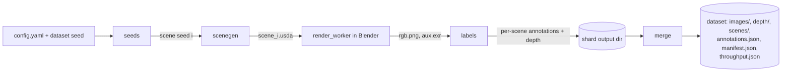
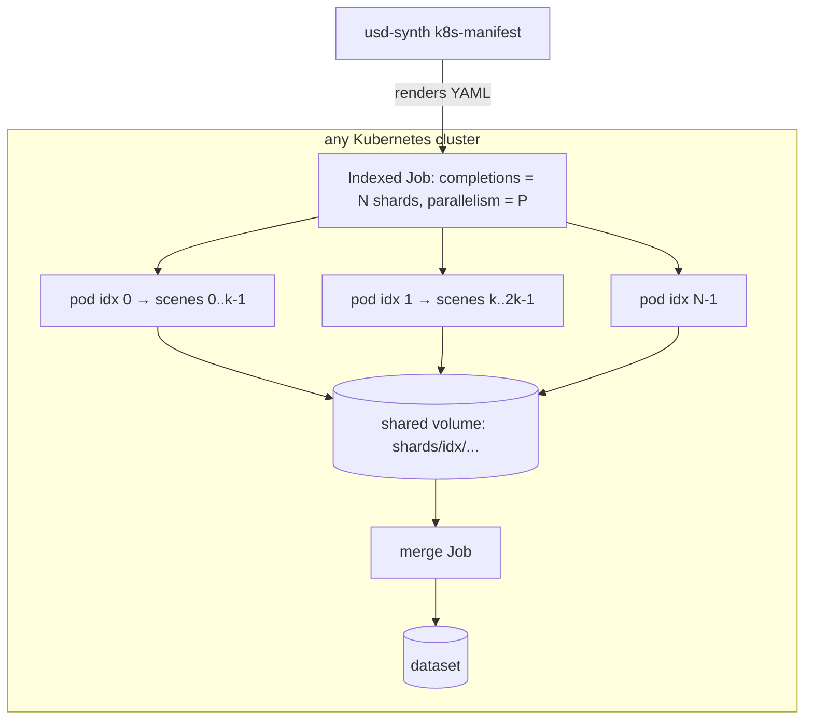

# Architecture

Status: planning. Nothing here is implemented yet; this document records the intended design
and the reasons for it. Items marked **verify in M*n*** are assumptions that the named
milestone must confirm with a test before relying on them.

## Components

| Component | Runs in | Responsibility |
|---|---|---|
| `config` | host Python | Load YAML, validate with a Pydantic model, compute a stable config hash. |
| `seeds` | host Python | Derive per-scene and per-stage random streams from `(dataset seed, scene index)`. |
| `scenegen` | host Python + `usd-core` | Sample a scene from the config and write a flattened `.usda` stage. One module per scenario (`tabletop` in the MVP). |
| `render_worker` | Blender's bundled Python (`blender -b --python`) | Import the stage, assign pass indices, configure Cycles, render RGB + auxiliary passes. Imports only `bpy`, the standard library and Blender's bundled `numpy`. |
| `labels` | host Python | Turn auxiliary passes into instance masks, boxes and depth; write COCO. |
| `pipeline` | host Python | Orchestrate generate → render → label for a shard; write per-scene outputs atomically; timing. |
| `merge` | host Python | Combine shard outputs into one dataset (`annotations.json`, `manifest.json`, `throughput.json`). |
| `cli` | host Python | `usd-synth scenes | render | generate | reproduce | merge | k8s-manifest`. |
| `deploy/k8s` | Kubernetes | Indexed Job template and merge Job template. |

Two Python environments exist on purpose: the host environment (scene generation, labelling,
orchestration) and Blender's bundled interpreter (rendering only). The boundary between them is
files on disk plus a small JSON job description passed on the Blender command line, which keeps
the render worker swappable for a different backend later.

## Data flow



Per scene *i*, the pipeline writes into `shards/<k>/scenes/<i>/` and only marks the scene
complete (an empty `DONE` file written last) after every output exists. A re-run of the same
shard skips completed scenes, so a retried pod resumes rather than starting over.

## Determinism and seeds

- `numpy.random.SeedSequence(entropy=dataset_seed, spawn_key=(scene_index,))` gives the scene
  stream. Because the stream depends only on the scene index, not on the order of generation,
  scene *i* is identical whether generated alone, in a full run, or in any shard (MVP
  acceptance criterion 3).
- Each stage gets a child stream with a fixed stage key (`objects`, `poses`, `materials`,
  `lighting`, `camera`, `render`), so adding a new randomized parameter in one stage does not
  shift the random numbers consumed by another.
- The Cycles sampling seed (`scene.cycles.seed`) is derived from the `render` stream.
- Floating-point values written to `.usda` are formatted with a fixed precision so the text is
  byte-stable across platforms.

**Reproducibility contract.** The USD stage and every label derived from geometry are
byte-reproducible. The RGB image is reproducible to the extent the renderer is: the same
Blender build on the same device type is expected to give identical output for the same seed
and sample count, while CPU vs GPU or different Blender versions can differ by noise-level
amounts (**verify in M5**; the `reproduce` test measures the difference and documents the
threshold). The manifest records the Blender version, device and sample count for this reason.

## USD stage layout

One self-contained, flattened `.usda` file per scene:

```
/World                         (Xform, defaultPrim; upAxis = "Z", metersPerUnit = 1.0)
  /World/Env
    /World/Env/Support         (Mesh: table top or bin; category "support", not labelled)
    /World/Env/Background      (Mesh: backdrop/floor plane)
  /World/Objects
    /World/Objects/inst_0001   (Xform + Mesh child; labelled instance)
    /World/Objects/inst_0002
    ...
  /World/Distractors
    /World/Distractors/dis_0001 (clutter; rendered but labelled as ignore/crowd per config)
  /World/Lights
    /World/Lights/Key          (UsdLux.SphereLight / RectLight)
    /World/Lights/Dome         (UsdLux.DomeLight, optional HDRI texture)
  /World/Camera                (UsdGeom.Camera, pinhole)
  /World/Looks
    /World/Looks/mat_0001      (UsdShade.Material with UsdPreviewSurface)
```

Each labelled instance prim carries custom attributes in the `userProperties` namespace:
`userProperties:usd_synth:instance_id` (int), `...:category_id` (int), `...:category_name`
(string), `...:asset` (string). The prim name `inst_NNNN` also encodes the instance ID.

Design choices driven by Blender's USD importer, per the
[Blender 5.2 manual's USD page](https://docs.blender.org/manual/en/5.2/files/import_export/usd.html):

- The manual states the importer "does not yet handle certain USD composition concepts, such
  as layers and references". The generator therefore authors with references (for assets) but
  **exports a flattened stage** (`Usd.Stage.Flatten()`), so the renderer receives a single
  layer with no composition arcs.
- Materials use `UsdPreviewSurface`, which the importer supports (with an option to convert to
  Principled BSDF). MaterialX is not relied on.
- The importer can import custom attributes in the `userProperties` namespace as Blender custom
  properties. The render worker reads `instance_id` from those properties, and **falls back to
  parsing the prim/object name** if the property is missing. Whether properties land on the
  object or its data block is **verify in M3**.
- `PointInstancer` imports as a point cloud with Geometry Nodes instancing, which would make
  per-instance pass indices awkward. The MVP writes every labelled instance as its own prim and
  does not use `PointInstancer` for labelled objects.

## Randomization config schema

YAML, validated by a Pydantic model; unknown keys are an error. Every numeric range is
`[min, max]`, sampled uniformly unless a `dist:` is given. Sketch of the tabletop scenario:

```yaml
version: 1
scenario: tabletop
image: { width: 640, height: 480 }
render:
  engine: cycles
  device: cpu            # cpu | gpu (gpu picks CUDA/OptiX/HIP/oneAPI/Metal if available)
  samples: 64
  denoise: true
objects:
  library:
    - { name: box,      source: primitive:box,      category: box,      size_m: [0.04, 0.12] }
    - { name: can,      source: primitive:cylinder, category: cylinder, size_m: [0.05, 0.10] }
    - { name: mug,      source: assets/mug.usdz,    category: mug }   # optional user asset
  count: [3, 12]
  placement:
    region: support      # sample on the support surface's top face
    min_separation_m: 0.005
    yaw_deg: [0, 360]
    allow_tipped: 0.2    # probability an object is placed on a random stable face
distractors: { count: [0, 8], label: ignore }
support:
  kind: [table, bin]     # categorical choice
  size_m: { x: [0.6, 1.2], y: [0.4, 0.8] }
materials:
  base_color: { h: [0, 1], s: [0.0, 0.9], v: [0.1, 1.0] }
  roughness: [0.1, 0.9]
  metallic: { choice: [0.0, 1.0], p: [0.85, 0.15] }
  textures: []           # optional list of image paths for random texture assignment
lighting:
  key_lights: [1, 3]
  intensity: [200, 2000]
  color_temp_k: [2700, 6500]
  dome: { enabled: true, intensity: [0.1, 1.0], hdris: [] }
camera:
  look_at: support_center
  distance_m: [0.6, 1.5]
  elevation_deg: [25, 80]
  azimuth_deg: [0, 360]
  focal_length_mm: [24, 50]
  jitter_target_m: 0.05
labels:
  min_visible_pixels: 50
  min_visible_fraction: 0.1   # of the unoccluded projected area; below → dropped
  depth: { format: png16_mm, max_m: 10.0 }
```

The resolved config (defaults filled in) and its SHA-256 hash are stored in `manifest.json`.

## Label generation

Labels come from renderer passes, not from re-projecting geometry, so occlusion is handled
exactly:

1. **Instance IDs.** The render worker sets each labelled object's `pass_index` to its
   `instance_id` (distractors and the environment get 0) and enables the Cycles Object Index
   pass. The pass is written to a multilayer EXR alongside depth.
2. **Masks.** `labels` reads the EXR (`OpenEXR` Python bindings), rounds the index channel to
   integers, and builds one binary mask per instance ID, encoded as COCO RLE with
   `pycocotools.mask.encode`.
   Whether the Object Index pass is free of anti-aliasing blends at edges (needed so rounding
   is correct) is **verify in M3**; the fallback is Cryptomatte, which Cycles also supports.
3. **Boxes.** Tight `[x, y, w, h]` from the mask extents (visible box, consistent with COCO).
4. **Visibility filtering.** To avoid extra renders, the generator records each instance's projected 3D bounding box; instances with
   fewer than `min_visible_pixels` visible pixels, or whose visible area is below
   `min_visible_fraction` of an estimate of their full area, are dropped. (A more
   exact alternative — a holdout render per instance — is too slow for the MVP.)
5. **Depth.** Cycles' perspective depth pass returns planar depth along the camera's view axis
   (changed to match EEVEE/OpenGL in
   [this Cycles commit](https://developer.blender.org/rB18cda8be8768b1e4ad9c359295142272e7aac6bf));
   **verify in M3** against a fixture plane at a known distance. Written as 16-bit PNG in
   millimetres (0 = no hit / beyond `max_m`) for broad tool compatibility, with the raw float
   EXR optionally kept.
6. **Categories.** Come from the config's object library; IDs are assigned in config order and
   stored in the COCO `categories` list.

### Why COCO

- It is the de facto interchange format for 2D detection and instance segmentation; most
  training frameworks and evaluation tools read it directly, and
  [`pycocotools`](https://pypi.org/project/pycocotools/) provides a reference loader, RLE
  encoder/decoder and evaluator, which doubles as a validator in tests.
- It covers exactly the MVP labels (boxes, instance masks, categories, `iscrowd` for
  distractors/ignore regions) with no custom schema.
- It has no slot for depth, so depth is stored as one image file per RGB image, referenced
  from an extra per-image field (`depth_file`); COCO readers ignore unknown fields.
- Alternatives considered: **BOP** (adds 6-DoF poses; worth a post-MVP converter since poses
  are known), **KITTI** (box-oriented, no instance masks in the 2D object format), **YOLO txt**
  (boxes/polygons only, no RLE, no shared metadata).

## Renderer choice

| Option | Runs on | USD path | License | Fit for MVP |
|---|---|---|---|---|
| **Blender Cycles** via `blender -b --python` (default) | CPU everywhere; GPU via CUDA/OptiX (NVIDIA), HIP (AMD), oneAPI (Intel), Metal (Apple) | Built-in USD importer (with the limits listed above) | GPL (Blender). The worker script is run by Blender as a separate program; the container image ships Blender under its own GPL terms, and this project's code stays MIT | **Chosen.** Runs in CI on CPU, no vendor lock-in, mature path tracer with Object Index and depth passes. Cost: slower than a real-time renderer; USD import is a conversion, not native. |
| `bpy` from PyPI (Blender as a Python module) | Same as above | Same | Same | Attractive (no separate Blender binary), but each `bpy` release targets one Python version (the 5.2 wheels require Python 3.13, per [PyPI](https://pypi.org/project/bpy/)) and older versions are removed from PyPI. Kept as an option; the MVP uses the Blender binary in a container for pinning. |
| [Omniverse Replicator / Isaac Sim](https://docs.isaacsim.omniverse.nvidia.com/latest/replicator_tutorials/index.html) | NVIDIA RTX-class GPU only | Native USD | Isaac Sim source Apache-2.0, plus required NVIDIA components under a [separate license](https://www.nvidia.com/en-us/agreements/enterprise-software/isaac-sim-additional-software-and-materials-license/) | Strongest USD fit and built-in annotators/`CocoWriter`, but excludes CPU-only machines and CI, and pulls in non-open components. **Candidate post-MVP backend.** |
| Blender EEVEE | GPU (OpenGL/Vulkan) required even headless | Same as Cycles | GPL | Much faster but needs a GPU context in containers; less physically accurate. Post-MVP option for throughput experiments. |
| Kubric / BlenderProc as the engine | — | No USD scene input | Apache-2.0 / GPL-3.0 | Would replace the USD contract with their own scene model; see CONCEPT.md prior art. |

## Kubernetes job topology



- **One Indexed Job** (`completionMode: Indexed`); Kubernetes sets `JOB_COMPLETION_INDEX` in
  each pod, which the worker uses as `--shard-index`. Shard *k* owns scene indices
  `[k·size, (k+1)·size)`.
- **Retries per shard** with `backoffLimitPerIndex` (GA since Kubernetes v1.33, per the
  [Kubernetes blog](https://kubernetes.io/blog/2025/05/13/kubernetes-v1-33-jobs-backoff-limit-per-index-goes-ga/)).
  Because completed scenes are skipped, a retried pod only renders what is left.
- **Output** goes to a shared volume (a ReadWriteMany PersistentVolumeClaim on multi-node
  clusters; on a single-node `kind` cluster a ReadWriteOnce volume is enough). Object storage is
  post-MVP.
- **Merge** runs as a second Job (or `usd-synth merge` locally against the same volume) after
  the Indexed Job reports `Complete`.
- **Resources**: CPU requests/limits set from the config; Blender is told the thread count
  matching the CPU limit so pods do not oversubscribe a node. GPU shards add a
  `nvidia.com/gpu`-style resource request only when `render.device: gpu`.
- The manifest is generated by the CLI from a template with plain YAML (no Helm or operator in
  the MVP) and applied with `kubectl apply`. Nothing is specific to one cloud or distribution.

## Throughput and performance

Throughput is reported by every run in `throughput.json`:

```json
{
  "images": 200,
  "wall_seconds": 1834.2,
  "images_per_hour": 392.5,
  "stages": { "generate": {"mean_s": 0.08, "p95_s": 0.12}, "blender_start": {...},
              "import": {...}, "render": {...}, "label": {...}, "write": {...} },
  "environment": { "blender": "5.2.x", "device": "cpu", "threads": 8, "cpu_model": "...",
                   "gpu": null, "samples": 64, "resolution": [640, 480] }
}
```

For a Kubernetes run, the merge step also computes cluster throughput as total images divided
by (last pod finish − first pod start), alongside per-pod figures, so scheduling overhead is
visible.

Expected levers, to be measured rather than assumed:

- **Render samples + denoising** dominate cost; the config makes both explicit.
- **Blender start-up and USD import** are paid per process. The worker renders a batch of
  scenes per Blender process (clearing the scene between them) instead of one process per
  scene; the batch size is a tunable.
- **Resolution** scales cost roughly with pixel count.
- **Label extraction** is NumPy over a few arrays per image and should be negligible; if it is
  not, it can run in parallel with the next render.
- **Parallelism**: shards × threads per shard should not exceed the cores on a node; the
  throughput report makes oversubscription visible.

## Dependencies

Versions are the latest available at planning time (October 2026) and become pins in
`pyproject.toml` / the Dockerfile in M1/M3.

| Dependency | Version | Used by | Notes |
|---|---|---|---|
| Python (host) | ≥ 3.11 | everything outside Blender | |
| [usd-core](https://pypi.org/project/usd-core/) | 26.8 | `scenegen`, tests | Pixar's OpenUSD Python wheels (`pxr`). |
| [Blender](https://www.blender.org/download/lts/) | 5.2 LTS (5.2.2) | `render_worker` | LTS line for a 2-year fix window; run headless via `blender -b`. |
| [numpy](https://pypi.org/project/numpy/) | 2.x | seeds, labels | `SeedSequence` for seed derivation. |
| [pydantic](https://pypi.org/project/pydantic/) | 2.14 | `config` | |
| [PyYAML](https://pypi.org/project/PyYAML/) | 6.0 | `config` | |
| [pycocotools](https://pypi.org/project/pycocotools/) | 2.0.11 | labels, tests | RLE encoding and COCO validation. |
| [OpenEXR](https://pypi.org/project/OpenEXR/) | 3.5 | labels | Reads the multilayer EXR passes. |
| [Pillow](https://pypi.org/project/pillow/) | 13.0 | labels | PNG writing (RGB, 16-bit depth). |
| pytest, ruff | 9.1, 0.17 | dev | |
| [kind](https://github.com/kubernetes-sigs/kind) | 0.33 | M7 integration test | Any conformant cluster ≥ v1.33 works for real runs. |

## Testing strategy

- **Unit (no Blender):** config validation; seed derivation stability (golden values) and
  independence; placement sampler (non-overlap, on-surface); USD writer output opened with
  `pxr` and checked structurally; label code on synthetic NumPy arrays (masks, boxes, RLE
  round-trip, visibility filtering); COCO writer validated with `pycocotools`; merge logic on
  fake shard directories.
- **Golden files:** a handful of small `.usda` scenes checked in; any change to generation
  output fails the test and must be accepted explicitly, which protects reproducibility of
  existing datasets.
- **Integration (Blender in container):** render a fixture scene with a cube at a known pose at
  low resolution and samples; assert box/mask/depth against analytically computed values
  (MVP acceptance criterion 6). Runs in CI on CPU.
- **End-to-end:** `usd-synth generate --count 4` at 160×120 and low samples, then
  `reproduce` on one image.
- **Cluster:** a `kind`-based job (CI-optional, documented to run locally) that runs a 4-shard
  Indexed Job and compares the merged dataset with a local run.

## Open questions

1. **Object Index pass vs Cryptomatte.** Is the Object Index pass free of edge blending in
   current Cycles, or should masks come from Cryptomatte from the start? (M3)
2. **Custom property placement on import.** Do `userProperties` attributes import onto the
   Blender object or its mesh data? The prim-name fallback covers both cases, but the cleaner
   path should be confirmed. (M3)
3. **Physics settling.** Is rejection-sampled placement enough for bin-picking realism, or is
   a physics settle step (e.g. PyBullet, as Kubric uses) needed soon after the MVP?
4. **Asset sources.** Which openly licensed object/texture/HDRI collections to recommend in
   docs (license must permit dataset redistribution)? The MVP ships only procedural primitives.
5. **Visible-fraction estimate.** Is the projected-3D-box area a good enough denominator for
   `min_visible_fraction`, or is a per-instance unoccluded render worth its cost?
6. **Shared storage.** RWX volumes are not available on every cluster; should object storage
   (S3-compatible) move into the MVP for the cluster path?
7. **Batch size per Blender process.** What batch size balances start-up amortization against
   memory growth and retry granularity?
8. **Second backend.** If a Replicator backend is added later, how much of the label pipeline
   can be shared, given Replicator has its own annotators?
