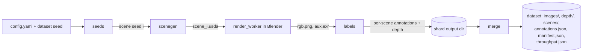
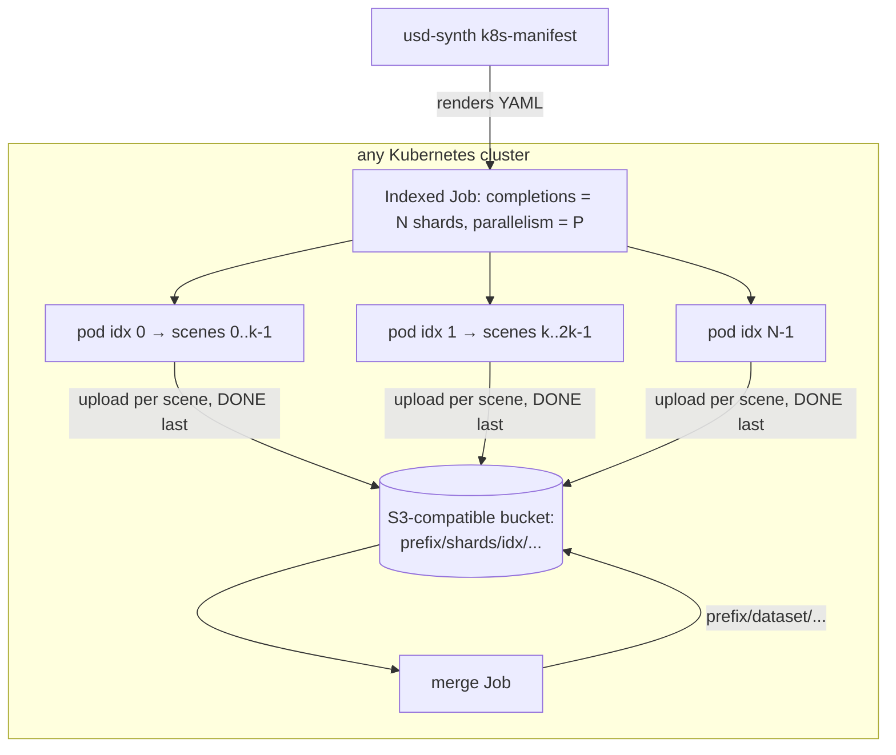

# Architecture

Status: in progress. Milestones are implemented in order (see [MVP.md](MVP.md)); sections
describe the design of record, and each milestone updates them as it lands. Items marked **verify in M*n*** are assumptions that the named
milestone must confirm with a test before relying on them.

## Components

| Component | Runs in | Responsibility |
|---|---|---|
| `config` | host Python | Load YAML, validate with a Pydantic model, compute a stable config hash. |
| `seeds` | host Python | Derive per-scene and per-stage random streams from `(dataset seed, scene index)`. |
| `scenegen` | host Python + `usd-core` | Sample a scene from the config and write a flattened `.usda` stage. One module per scenario (`tabletop` in the MVP; an outdoor `terrain` scenario is planned after it). |
| `render_worker` | Blender's bundled Python (`blender -b --python`) | `blender_worker.py`: for each scene of a batch, reset to an empty file, import the stage, assign pass indices, configure Cycles (device, samples, denoiser, seed, threads, resolution), render, and write `rgb.png`, `aux.exr` (multilayer: Combined, Depth, Object Index) and `render.json` (timings, Blender version, device). Imports only `bpy` and the standard library. The host side (`render.py`) reads per-scene inputs from the stage and passes them as a JSON job; `render.batch_size` scenes share one Blender process. |
| `labels` | host Python | Turn auxiliary passes into instance masks, boxes and depth; write COCO. |
| `pipeline` | host Python | Orchestrate generate → render → label for a shard; write per-scene outputs atomically; timing. |
| `merge` | host Python | Combine shard outputs into one dataset (`annotations.json`, `manifest.json`, `throughput.json`). |
| `storage` | host Python | Output sink behind one small interface (put file, mark scene done, list done scenes, read shard outputs). Local-filesystem sink for M1–M6; S3-compatible object-storage sink added in M7. |
| `cli` | host Python | `usd-synth config | scenes | render | generate | reproduce | merge | k8s-manifest` (`config` validates a config and prints its hash). `--out` takes a filesystem path, or (from M7) an `s3://bucket/prefix` URI. |
| `deploy/k8s` | Kubernetes | Indexed Job template and merge Job template. |

Two Python environments exist on purpose: the host environment (scene generation, labelling,
orchestration) and Blender's bundled interpreter (rendering only). The boundary between them is
files on disk plus a small JSON job description passed on the Blender command line, which keeps
the render worker swappable for a different backend later.

## Data flow



Per scene *i*, the pipeline writes into `shards/<k>/scenes/<i>/` and only marks the scene
complete (an empty `DONE` file written last) after every output exists. A re-run of the same
shard skips completed scenes, so a retried pod resumes rather than starting over.

The shard and dataset paths are relative to the output sink, not to a mounted filesystem.
For M1–M6 the sink is a local directory. From M7 the same layout can live under a prefix in
an S3-compatible bucket: each pod renders into its own local scratch directory, uploads a
scene's outputs, and uploads the `DONE` object last; resume and merge find completed scenes
by listing `DONE` objects. Object stores have no atomic rename, so "`DONE` is written last"
is the only completion signal the design relies on.

## Determinism and seeds

- `numpy.random.SeedSequence(entropy=dataset_seed, spawn_key=(scene_index,))` gives the scene
  stream. Because the stream depends only on the scene index, not on the order of generation,
  scene *i* is identical whether generated alone, in a full run, or in any shard (MVP
  acceptance criterion 3).
- Each stage gets a child stream with a fixed stage key (`support`, `objects`, `poses`,
  `distractors`, `materials`, `lighting`, `camera`, `render`), so adding a new randomized
  parameter in one stage does not shift the random numbers consumed by another. The child is
  `SeedSequence(entropy=dataset_seed, spawn_key=(scene_index, crc32(stage_name)))`, so adding a
  stage never renumbers existing ones. Golden-value tests in `tests/test_seeds.py` pin the
  first draws of several streams; a stream-independence test proves extra draws in one stage
  leave the others unchanged.
- The Cycles sampling seed (`scene.cycles.seed`) is derived from the `render` stream.
- Floating-point values written to `.usda` are rounded before authoring so the text is
  byte-stable across platforms: 6 decimals for points, colours and scalars, 12 for transform
  matrices (so a large asset scaled down to centimetres keeps its exact size). The dataset seed
  must be in `[0, 2**63 - 1]`; it is stored as a signed 64-bit attribute. Byte identity (same seed/index twice; scene *i* alone vs
  inside a range) is tested in `tests/test_scenegen.py`.

**Reproducibility contract.** The USD stage and every label derived from geometry are
byte-reproducible. The RGB image is reproducible to the extent the renderer is: the same
Blender build on the same device type is expected to give identical output for the same seed
and sample count, while CPU vs GPU or different Blender versions can differ by noise-level
amounts (**verify in M5**; the `reproduce` test measures the difference and documents the
threshold). The manifest records the Blender version, device and sample count for this reason.

## USD stage layout

One self-contained, flattened `.usda` file per scene:

```
/World                         (Xform, defaultPrim; upAxis = "Z", metersPerUnit = 1.0)
  /World/Looks
    /World/Looks/mat_0001      (UsdShade.Material with UsdPreviewSurface; optional UsdUVTexture)
  /World/Env
    /World/Env/Support         (Xform: Mesh "top" slab, plus four wall Meshes for a bin;
                                category "support", not labelled; top face at z = 0)
    /World/Env/Background      (Mesh: 20 m floor plane at z = -0.75)
  /World/Objects
    /World/Objects/inst_0001   (Xform with one transform op; labelled instance)
      .../inst_0001_geom       (Mesh child; or "asset" for a flattened user asset)
    ...
  /World/Distractors
    /World/Distractors/dis_0004 (clutter; IDs continue after the objects' IDs)
  /World/Lights
    /World/Lights/Key_1        (UsdLux.SphereLight; colour from a sampled colour temperature)
    /World/Lights/Dome         (UsdLux.DomeLight, optional HDRI texture)
  /World/Camera                (UsdGeom.Camera, pinhole, horizontal sensor fit)
```

Custom attributes, all in the `userProperties:usd_synth:` namespace:

| Prim | Attributes |
|---|---|
| `/World` | `scene_index`, `dataset_seed`, `image_width`, `image_height`, `support_kind`, `categories` (labelled category names in config order; COCO id = position + 1) |
| `inst_NNNN`, `dis_NNNN` | `instance_id` (int, 1-based, unique per scene; the Cycles pass index), `category_id` (int; 0 for distractors), `category_name`, `asset` (library entry name or `distractor:<shape>`), `kind` (`object` or `distractor`), `projected_bbox` (`[x, y, w, h]` px of all projected mesh points, unclipped), `projected_area_px` (area of their convex hull) |
| `/World/Camera` | `focal_length_mm`, `sensor_width_mm` (the renderer reads these rather than relying on unit conversion of the USD camera attributes) |

The prim name `inst_NNNN` / `dis_NNNN` (and the mesh child `inst_NNNN_geom`) also encodes the
instance ID. The generator places objects first, then distractors, all on the support top with
an axis-aligned footprint test (`min_separation_m` apart); an object with no free spot after
100 attempts is dropped, deterministically. Golden files in `tests/golden/` pin the generated
text for a small fixture config.

User assets are referenced by their `defaultPrim` (an asset without one is rejected), and only
that prim is bounded for placement. The asset's own `metersPerUnit` and `upAxis` are converted
into the instance transform (references do not convert them), an optional `size_m` then sets
its largest extent, and the sampled material is bound `strongerThanDescendants` so it overrides
the asset's own bindings.

Design choices driven by Blender's USD importer, per the
[Blender 5.2 manual's USD page](https://docs.blender.org/manual/en/5.2/files/import_export/usd.html):

- The manual states the importer "does not yet handle certain USD composition concepts, such
  as layers and references". The generator therefore authors with references (for assets) but
  **exports a flattened stage** (`Usd.Stage.Flatten()`), so the renderer receives a single
  layer with no composition arcs.
- Materials use `UsdPreviewSurface`, which the importer supports (with an option to convert to
  Principled BSDF). MaterialX is not relied on.
- The importer can import custom attributes in the `userProperties` namespace as Blender custom
  properties. The render worker reads `instance_id` from those properties, and **falls back to
  parsing the prim/object name** if the property is missing. **Verified in M3 (Blender
  5.2.2):** with the importer's default `merge_parent_xform`, an instance Xform and its single
  Mesh child become one Blender object named after the *child* (`inst_0001_geom`), and the
  Xform's `userProperties:usd_synth:*` attributes land on that **object** as `usd_synth:*`
  custom properties (camera attributes land on the camera *data*). The name fallback therefore
  matches `inst_NNNN` / `dis_NNNN` as a prefix. Tested by
  `tests/test_render.py::test_instance_ids_come_from_custom_properties_on_the_object`, which
  also renders a copy with the attribute stripped.
- Other importer behaviour found in M3 and handled by the worker: camera focal length and
  aperture are multiplied by 100 on import (unit conversion), so the worker sets `lens` and
  `sensor_width` from the camera's `focal_length_mm` / `sensor_width_mm` attributes; a
  `DomeLight` without a texture is not imported at all, so the host passes the dome's
  intensity, colour and texture in the job JSON and the worker builds the world shader; a
  `SphereLight` imports as a point light of `intensity × π` W (the bundled lighting range was
  calibrated to `[30, 300]` from renders); meshes without authored normals import smooth-shaded,
  so the generator authors face-varying normals with a 30° crease angle.
- `PointInstancer` imports as a point cloud with Geometry Nodes instancing, which would make
  per-instance pass indices awkward. The MVP writes every labelled instance as its own prim and
  does not use `PointInstancer` for labelled objects.

## Randomization config schema

YAML, validated by a Pydantic model; unknown keys are an error. Every numeric range is
`[min, max]` and sampled uniformly (other distributions are post-MVP). Every validation error
names the offending field as a dotted path (e.g. `objects.count: min (12) must be <= max (3)`).
The tabletop schema, as implemented in `src/usd_synth/config.py` (the bundled
`configs/tabletop.yaml` is the full example):

```yaml
version: 1
scenario: tabletop
image: { width: 640, height: 480 }
render:
  engine: cycles
  device: cpu            # cpu | gpu (gpu picks CUDA/OptiX/HIP/oneAPI/Metal if available)
  samples: 64
  denoise: true
  threads: 0            # 0 = let Blender decide
  batch_size: 8          # scenes rendered per Blender process
objects:
  library:
    - { name: box,      source: primitive:box,      category: box,      size_m: [0.04, 0.12] }
    - { name: can,      source: primitive:cylinder, category: cylinder, size_m: [0.05, 0.10] }
    - { name: mug,      source: assets/mug.usdz,    category: mug }   # optional user asset
  count: [3, 12]
  placement:
    region: support      # sample on the support surface's top face
    min_separation_m: 0.005
    yaw_deg: [0, 360]
    allow_tipped: 0.2    # probability an object is placed on a random stable face
distractors: { count: [0, 8], label: ignore, size_m: [0.02, 0.06] }  # label: ignore | omit
support:
  kind: [table, bin]     # categorical choice
  size_m: { x: [0.6, 1.2], y: [0.4, 0.8] }
materials:
  base_color: { h: [0, 1], s: [0.0, 0.9], v: [0.1, 1.0] }
  roughness: [0.1, 0.9]
  metallic: { choice: [0.0, 1.0], p: [0.85, 0.15] }
  textures: []           # optional list of image paths for random texture assignment
lighting:
  key_lights: [1, 3]
  intensity: [30, 300]   # USD inputs:intensity; Blender imports a point light of intensity × π W
  color_temp_k: [2700, 6500]
  dome: { enabled: true, intensity: [0.1, 1.0], hdris: [] }
camera:
  look_at: support_center
  distance_m: [0.6, 1.5]
  elevation_deg: [25, 80]
  azimuth_deg: [0, 360]
  focal_length_mm: [24, 50]
  sensor_width_mm: 36    # horizontal sensor fit
  jitter_target_m: 0.05
labels:
  min_visible_pixels: 50
  min_visible_fraction: 0.1   # of the unoccluded projected area; below → dropped
  depth: { format: png16_mm, max_m: 10.0, keep_exr: false }
```

The resolved config (defaults filled in) and its SHA-256 hash are stored in `manifest.json`.

## Label generation

Labels come from renderer passes, not from re-projecting geometry, so occlusion is handled
exactly:

1. **Instance IDs.** The render worker sets the `pass_index` of every instance — labelled
   objects *and* distractors — to its `instance_id`; the support, floor and everything else
   get 0. Distractors keep their own IDs so the label stage can turn them into `iscrowd`
   regions (`distractors.label: ignore`) or drop them (`omit`) without re-rendering; this is a
   deliberate change from the original plan, where distractors shared 0 with the environment.
   The worker enables the Cycles Object Index pass. The pass is written to a multilayer EXR alongside depth.
2. **Masks.** `labels` reads the EXR (`OpenEXR` Python bindings), rounds the index channel to
   integers, and builds one binary mask per instance ID, encoded as COCO RLE with
   `pycocotools.mask.encode`.
   **Verified in M3:** in Cycles (Blender 5.2.2) the Object Index pass holds exact integers
   with no anti-aliasing blend at edges (`test_index_pass_has_no_edge_blending`), so rounding
   is exact and Cryptomatte is not needed; `usd_synth.passes.read_passes` still rejects a
   non-integral index pass rather than guess.
3. **Boxes.** Tight `[x, y, w, h]` from the mask extents (visible box, consistent with COCO).
4. **Visibility filtering.** To avoid extra renders, the generator records each instance's
   projected box and the convex-hull area of its projected mesh points (`projected_bbox`,
   `projected_area_px`; for user assets the hull of their bounding-box corners); instances with
   fewer than `min_visible_pixels` visible pixels, or whose visible area is below
   `min_visible_fraction` of an estimate of their full area, are dropped. (A more
   exact alternative — a holdout render per instance — is too slow for the MVP.)
5. **Depth.** Cycles' perspective depth pass returns planar depth along the camera's view axis
   (changed to match EEVEE/OpenGL in
   [this Cycles commit](https://developer.blender.org/rB18cda8be8768b1e4ad9c359295142272e7aac6bf));
   **verified in M3:** with the camera 1 m above a table, depth is 1.000 m ± 1 mm across the
   whole table including the image corners, where radial distance would be about 19 % larger
   (`test_depth_is_planar`). Written as 16-bit PNG in
   millimetres (0 = no hit / beyond `max_m`) for broad tool compatibility, with the raw float
   EXR optionally kept.
6. **Categories.** Come from the config's object library; IDs are assigned in config order and
   stored in the COCO `categories` list.

### Why COCO

- It is the de facto interchange format for 2D detection and instance segmentation; most
  training frameworks and evaluation tools read it directly, and
  [`pycocotools`](https://pypi.org/project/pycocotools/) provides a reference loader, RLE
  encoder/decoder and evaluator, which doubles as a validator in tests.
- It covers exactly the MVP labels (boxes, instance masks, categories, `iscrowd` for
  distractors/ignore regions) with no custom schema.
- It has no slot for depth, so depth is stored as one image file per RGB image, referenced
  from an extra per-image field (`depth_file`); COCO readers ignore unknown fields.
- Alternatives considered: **BOP** (adds 6-DoF poses; worth a post-MVP converter since poses
  are known), **KITTI** (box-oriented, no instance masks in the 2D object format), **YOLO txt**
  (boxes/polygons only, no RLE, no shared metadata).

## Renderer choice

| Option | Runs on | USD path | License | Fit for MVP |
|---|---|---|---|---|
| **Blender Cycles** via `blender -b --python` (default) | CPU everywhere; GPU via CUDA/OptiX (NVIDIA), HIP (AMD), oneAPI (Intel), Metal (Apple) | Built-in USD importer (with the limits listed above) | GPL (Blender). The worker script is run by Blender as a separate program; the container image ships Blender under its own GPL terms, and this project's code stays MIT | **Chosen.** Runs in CI on CPU, no vendor lock-in, mature path tracer with Object Index and depth passes. Cost: slower than a real-time renderer; USD import is a conversion, not native. |
| `bpy` from PyPI (Blender as a Python module) | Same as above | Same | Same | Attractive (no separate Blender binary), but each `bpy` release targets one Python version (the 5.2 wheels require Python 3.13, per [PyPI](https://pypi.org/project/bpy/)) and older versions are removed from PyPI. Kept as an option; the MVP uses the Blender binary in a container for pinning. |
| [Omniverse Replicator / Isaac Sim](https://docs.isaacsim.omniverse.nvidia.com/latest/replicator_tutorials/index.html) | NVIDIA RTX-class GPU only | Native USD | Isaac Sim source Apache-2.0, plus required NVIDIA components under a [separate license](https://www.nvidia.com/en-us/agreements/enterprise-software/isaac-sim-additional-software-and-materials-license/) | Strongest USD fit and built-in annotators/`CocoWriter`, but excludes CPU-only machines and CI, and pulls in non-open components. **Candidate post-MVP backend.** |
| Blender EEVEE | GPU (OpenGL/Vulkan) required even headless | Same as Cycles | GPL | Much faster but needs a GPU context in containers; less physically accurate. Post-MVP option for throughput experiments. |
| Kubric / BlenderProc as the engine | — | No USD scene input | Apache-2.0 / GPL-3.0 | Would replace the USD contract with their own scene model; see CONCEPT.md prior art. |

## Kubernetes job topology



- **One Indexed Job** (`completionMode: Indexed`); Kubernetes sets `JOB_COMPLETION_INDEX` in
  each pod, which the worker uses as `--shard-index`. Shard *k* owns scene indices
  `[k·size, (k+1)·size)`.
- **Retries per shard** with `backoffLimitPerIndex` (GA since Kubernetes v1.33, per the
  [Kubernetes blog](https://kubernetes.io/blog/2025/05/13/kubernetes-v1-33-jobs-backoff-limit-per-index-goes-ga/)).
  Because completed scenes are skipped, a retried pod only renders what is left.
- **Output** goes to S3-compatible object storage, under `s3://<bucket>/<prefix>/shards/<k>/...`
  (decided 2026-10-17; see [Decisions](#decisions)). No ReadWriteMany volume is required, so
  the same manifest works on single-node and multi-node clusters. Each pod renders into a local
  scratch directory (an `emptyDir`), uploads each finished scene's files, then uploads the
  scene's `DONE` object. A retried pod lists the `DONE` objects under its shard prefix and
  skips those scenes.
- **Endpoint and credentials** come from a Kubernetes Secret referenced by the manifest
  (endpoint URL, access key, secret key), never from the dataset config, so the config hash
  does not change between storage targets. Any S3-compatible endpoint works; the M7 test uses
  MinIO deployed inside the `kind` cluster.
- **Merge** runs as a second Job (or `usd-synth merge` locally, pointed at the same bucket
  prefix) after the Indexed Job reports `Complete`. It reads the shard outputs through the
  `storage` interface and writes the merged dataset under `s3://<bucket>/<prefix>/dataset/`.
  The merge logic itself is the M6 code; only the sink differs.
- **Local runs (M1–M6)** keep the local-filesystem sink with the identical layout, so nothing
  before M7 needs an object store.
- **Resources**: CPU requests/limits set from the config; Blender is told the thread count
  matching the CPU limit so pods do not oversubscribe a node. GPU shards add a
  `nvidia.com/gpu`-style resource request only when `render.device: gpu`.
- The manifest is generated by the CLI from a template with plain YAML (no Helm or operator in
  the MVP) and applied with `kubectl apply`. Nothing is specific to one cloud or distribution.

## Throughput and performance

Throughput is reported by every run in `throughput.json`:

```json
{
  "images": 200,
  "wall_seconds": 1834.2,
  "images_per_hour": 392.5,
  "stages": { "generate": {"mean_s": 0.08, "p95_s": 0.12}, "blender_start": {...},
              "import": {...}, "render": {...}, "label": {...}, "write": {...} },
  "environment": { "blender": "5.2.x", "device": "cpu", "threads": 8, "cpu_model": "...",
                   "gpu": null, "samples": 64, "resolution": [640, 480] }
}
```

For a Kubernetes run, the merge step also computes cluster throughput as total images divided
by (last pod finish − first pod start), alongside per-pod figures, so scheduling overhead is
visible.

Expected levers, to be measured rather than assumed:

- **Render samples + denoising** dominate cost; the config makes both explicit.
- **Blender start-up and USD import** are paid per process. The worker renders a batch of
  scenes per Blender process (clearing the scene between them) instead of one process per
  scene; the batch size is a tunable.
- **Resolution** scales cost roughly with pixel count.
- **Label extraction** is NumPy over a few arrays per image and should be negligible; if it is
  not, it can run in parallel with the next render.
- **Parallelism**: shards × threads per shard should not exceed the cores on a node; the
  throughput report makes oversubscription visible.

## Dependencies

Versions are the latest available at planning time (October 2026) and are pinned exactly in
`pyproject.toml` (from M1) and the Dockerfile (from M3) as each milestone starts using them.

| Dependency | Version | Used by | Notes |
|---|---|---|---|
| Python (host) | ≥ 3.12 | everything outside Blender | numpy 2.5 requires 3.12. CI runs 3.12. |
| [usd-core](https://pypi.org/project/usd-core/) | 26.8 | `scenegen`, tests | Pixar's OpenUSD Python wheels (`pxr`). |
| [Blender](https://www.blender.org/download/lts/) | 5.2 LTS (5.2.2) | `render_worker` | LTS line for a 2-year fix window; run headless via `blender -b --factory-startup --python`. Pinned with its SHA-256 in the `Dockerfile` and the CI `render tests` job; the bundled Python includes numpy and `pxr` 26.3, but the worker uses only `bpy` and the standard library. |
| [numpy](https://pypi.org/project/numpy/) | 2.5.4 | seeds, labels | `SeedSequence` for seed derivation. |
| [pydantic](https://pypi.org/project/pydantic/) | 2.14.1 | `config` | |
| [PyYAML](https://pypi.org/project/PyYAML/) | 6.0.3 | `config` | |
| [pycocotools](https://pypi.org/project/pycocotools/) | 2.0.11 | labels, tests | RLE encoding and COCO validation. |
| [OpenEXR](https://pypi.org/project/OpenEXR/) | 3.5.2 | `passes`, labels | Reads the multilayer EXR passes. |
| [Pillow](https://pypi.org/project/pillow/) | 13.0.0 | labels, tests | PNG reading/writing (RGB, 16-bit depth). |
| pytest, ruff | 9.1.1, 0.17.1 | dev | CI runs `ruff check`, `ruff format --check` and `pytest`. |
| [kind](https://github.com/kubernetes-sigs/kind) | 0.33 | M7 integration test | Any conformant cluster ≥ v1.33 works for real runs. |
| S3 client library | chosen and pinned in M7 | `storage` (S3 sink) | Host-side only; must accept a custom endpoint URL so any S3-compatible store works. |
| [MinIO](https://github.com/minio/minio) | pinned in M7 | M7 integration test | S3-compatible object store run inside the `kind` cluster. |

## Testing strategy

- **Unit (no Blender):** config validation; seed derivation stability (golden values) and
  independence; placement sampler (non-overlap, on-surface); USD writer output opened with
  `pxr` and checked structurally; label code on synthetic NumPy arrays (masks, boxes, RLE
  round-trip, visibility filtering); COCO writer validated with `pycocotools`; merge logic on
  fake shard directories.
- **Golden files:** a handful of small `.usda` scenes checked in; any change to generation
  output fails the test and must be accepted explicitly, which protects reproducibility of
  existing datasets.
- **Integration (Blender in container):** render a fixture scene with a cube at a known pose at
  low resolution and samples; assert box/mask/depth against analytically computed values
  (MVP acceptance criterion 6). Runs in CI on CPU.
- **End-to-end:** `usd-synth generate --count 4` at 160×120 and low samples, then
  `reproduce` on one image.
- **Storage sinks:** the same resume/merge tests run against the local-filesystem sink
  (M6) and, from M7, against a MinIO bucket, so both sinks honour the same `DONE`-last
  contract.
- **Cluster:** a `kind`-based job (CI-optional, documented to run locally) that deploys MinIO
  in the cluster, runs a 4-shard Indexed Job writing to it, and compares the merged dataset
  with a local run.

## Decisions

Recorded 2026-10-17. Each entry was previously an open question or an unstated assumption.

1. **Kubernetes fan-out stays in the MVP as M7**, the last milestone, and is tested on a local
   `kind` cluster. Milestones M1–M6 work and are tested on a single machine without a cluster
   (see [MVP.md](MVP.md)).
2. **Second scenario (post-MVP): outdoor terrain** — procedurally generated terrain with
   scattered vegetation and props, added as a second `scenegen` module behind the same config
   and scene-builder interface. It replaces the earlier plan of indoor rooms as the second
   scenario; indoor rooms remain a possible later scenario. Rendering cost per image is
   expected to be markedly higher than tabletop (larger extents, much more geometry,
   vegetation), which the throughput report will quantify.
3. **Physics settling: yes, post-MVP**, after M7. Objects are dropped and simulated to rest
   before rendering. The engine (Blender rigid-body or PyBullet) is not chosen yet. Whatever
   engine is used, the settle step must be driven by its own seeded stage stream and write the
   settled poses into the `.usda`, so a scene stays reproducible from its seed and the stage
   remains the single contract with the renderer.
4. **Cluster storage: S3-compatible object storage.** The Kubernetes path writes shard outputs
   and the merged dataset to an S3-compatible bucket (MinIO on `kind` for tests); no
   ReadWriteMany volume is required. A local-filesystem sink with the same layout stays the
   only sink for M1–M6 (see [Kubernetes job topology](#kubernetes-job-topology)).

## Open questions

1. **Object Index pass vs Cryptomatte.** Resolved in M3: the Object Index pass is exact, no
   Cryptomatte needed (see Label generation, step 2).
2. **Custom property placement on import.** Resolved in M3: on the object, after the
   importer merges the instance Xform with its mesh (see USD stage layout).
3. **Asset sources.** Which openly licensed object/texture/HDRI collections to recommend in
   docs (license must permit dataset redistribution)? The MVP ships only procedural primitives.
4. **Visible-fraction estimate.** Is the projected-3D-box area a good enough denominator for
   `min_visible_fraction`, or is a per-instance unoccluded render worth its cost?
5. **Batch size per Blender process.** What batch size balances start-up amortization against
   memory growth and retry granularity?
6. **Second backend.** If a Replicator backend is added later, how much of the label pipeline
   can be shared, given Replicator has its own annotators?
