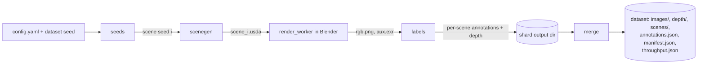
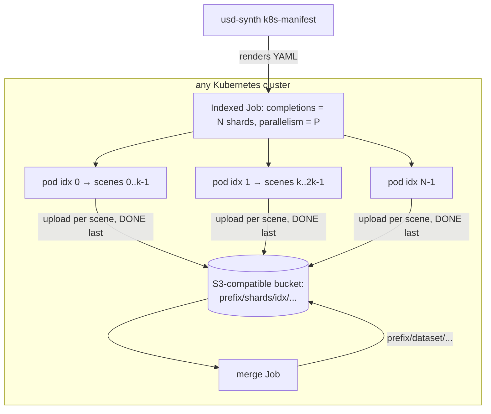

# Architecture

Status: MVP implemented (M1–M7, see [MVP.md](MVP.md)). This document is the design of record;
each verification point the plan left open is recorded below with the test that settled it.

## Components

| Component | Runs in | Responsibility |
|---|---|---|
| `config` | host Python | Load YAML, validate with a Pydantic model, compute a stable config hash. |
| `seeds` | host Python | Derive per-scene and per-stage random streams from `(dataset seed, scene index)`. |
| `scenegen` | host Python + `usd-core` | Sample a scene from the config and write a flattened `.usda` stage. One module per scenario (`tabletop` in the MVP; an outdoor `terrain` scenario is planned after it). |
| `render_worker` | Blender's bundled Python (`blender -b --python`) | `blender_worker.py`: for each scene of a batch, reset to an empty file, import the stage, assign pass indices, configure Cycles (device, samples, denoiser, seed, threads, resolution), render, and write `rgb.png`, `aux.exr` (multilayer: Combined, Depth, Object Index) and `render.json` (timings, Blender version, device). Imports only `bpy` and the standard library. The host side (`render.py`) reads per-scene inputs from the stage and passes them as a JSON job; `render.batch_size` scenes share one Blender process. |
| `strata_backend` | host Python + `libstrata.so` (through the `strata-engine` binding) | `render.engine: strata` (optional; Cycles stays the default): read the flattened stage with `pxr`, draw it with [Strata](https://github.com/Preponderous-Software/strata) headless on Mesa llvmpipe (one EGL context per process, reused), and write the same `rgb.png`, `aux.exr` and `render.json` as the Blender worker. `strata.py` adapts Strata's official Python binding to NumPy; see [Strata backend](#strata-backend). |
| `labels` | host Python | Turn auxiliary passes into instance masks, boxes and depth; write COCO. |
| `pipeline` | host Python | Orchestrate generate → render → label for a shard; write per-scene outputs atomically; timing. |
| `merge` | host Python | Combine shard outputs into one dataset (`annotations.json`, `manifest.json`, `throughput.json`). |
| `storage` | host Python | Output sink behind one small interface (put file, mark scene done, list done scenes, read shard outputs). Local-filesystem sink for M1–M6; S3-compatible object-storage sink added in M7. |
| `cli` | host Python | `usd-synth config | scenes | render | generate | reproduce | merge | k8s-manifest` (`config` validates a config and prints its hash; `generate` takes `--workers`, `--shard-index/--shard-count`, `--batch-size`, `--threads`). `--out` takes a filesystem path, or (from M7) an `s3://bucket/prefix` URI. |
| `k8s` | host Python | `usd-synth k8s-manifest`: render the ConfigMap, Indexed Job and merge Job as plain YAML for `kubectl apply` (see Kubernetes job topology). `deploy/` holds only test infrastructure: the in-cluster MinIO manifest for `kind` and the MinIO image build. |

Two Python environments exist on purpose: the host environment (scene generation, labelling,
orchestration) and Blender's bundled interpreter (rendering only). The boundary between them is
files on disk plus a small JSON job description passed on the Blender command line, which keeps
the render worker swappable for a different backend later.

## Data flow



Per scene *i*, the pipeline writes into `shards/<k>/scenes/<i>/` (`scene.usda`, `rgb.png`,
`depth.png`, `labels.json`, `timings.json`, optionally `aux.exr`) and only marks the scene
complete (an empty `DONE` file written last) after every output exists. A re-run of the same
shard skips completed scenes, so a retried pod resumes rather than starting over; a scene
directory without `DONE` is cleared and redone. Rendering happens in a scratch directory, so a
crash never leaves a half-written scene that looks complete. Each shard's `shard.json`
records its range, the config (resolved, with hash), seed, count and shard count, and a resume
with different values is refused. `usd-synth merge` (run automatically by `generate` unless
`--shard-index` is given) checks that all shards describe one run, that their ranges neither
overlap nor leave gaps, and that every scene has `DONE`; it then copies the finished scenes
into `images/`, `depth/` and `scenes/` and writes `annotations.json` (validated before the
command exits), `manifest.json` (with the shard list) and `throughput.json`.

Sharding: shard *k* of *n* owns `[k·size, min((k+1)·size, count))` with
`size = ceil(count / n)`. `generate --workers N` runs N local shards as separate processes
(and, if `render.threads` is 0, gives each Blender `cpu_count // N` threads so they do not
oversubscribe the CPU); `generate --shard-index k --shard-count n` runs one shard and stops, for
a later `usd-synth merge --out <dir>`. Resume and merge go through the `storage.Sink` interface
(`put_file`, `put_bytes`, `get_bytes`, `exists`, `list`, `copy`, `mark_done`, `done_scenes`,
`shards`) and rely only on "`DONE` is written last". `LocalSink` is the only sink before M7;
`tests/test_storage_merge.py` runs the resume/merge contract through the interface so the S3
sink can be checked by the same tests.

The shard and dataset paths are relative to the output sink, not to a mounted filesystem.
`--out` is a local directory (`LocalSink`, dataset at the directory root) or
`s3://<bucket>/<prefix>` (`S3Sink`, dataset under `<prefix>/dataset/`), with the same shard
layout. On a cluster each pod renders into its own local scratch directory, uploads a
scene's outputs, and uploads the `DONE` object last; resume and merge find completed scenes
by listing `DONE` objects. Object stores have no atomic rename, so "`DONE` is written last"
is the only completion signal the design relies on.

## Determinism and seeds

- `numpy.random.SeedSequence(entropy=dataset_seed, spawn_key=(scene_index,))` gives the scene
  stream. Because the stream depends only on the scene index, not on the order of generation,
  scene *i* is identical whether generated alone, in a full run, or in any shard (MVP
  acceptance criterion 3).
- Each stage gets a child stream with a fixed stage key (`support`, `objects`, `poses`,
  `distractors`, `materials`, `lighting`, `camera`, `render`), so adding a new randomized
  parameter in one stage does not shift the random numbers consumed by another. The child is
  `SeedSequence(entropy=dataset_seed, spawn_key=(scene_index, crc32(stage_name)))`, so adding a
  stage never renumbers existing ones. Golden-value tests in `tests/test_seeds.py` pin the
  first draws of several streams; a stream-independence test proves extra draws in one stage
  leave the others unchanged.
- The Cycles sampling seed (`scene.cycles.seed`) is derived from the `render` stream.
- Floating-point values written to `.usda` are rounded before authoring so the text is
  byte-stable across platforms: 6 decimals for points, colours and scalars, 12 for transform
  matrices (so a large asset scaled down to centimetres keeps its exact size). The dataset seed
  must be in `[0, 2**63 - 1]`; it is stored as a signed 64-bit attribute. Byte identity (same seed/index twice; scene *i* alone vs
  inside a range) is tested in `tests/test_scenegen.py`.

**Reproducibility contract.** The USD stage and every label derived from geometry are
byte-reproducible. The RGB image is reproducible to the extent the renderer is: the same
Blender build on the same device type is expected to give identical output for the same seed
and sample count, while CPU vs GPU or different Blender versions can differ by noise-level
amounts. The manifest records the Blender version, device and sample count for this reason.
**Measured in M5:** `usd-synth reproduce` compares the regenerated image with the original by
mean absolute difference over all RGB channels in 8-bit levels; the threshold is **1.0**
(`reproduce.RGB_MAD_THRESHOLD`). On the same Blender 5.2.2 build and CPU device the measured
difference is **0.0** (bit-identical PNGs), both locally and in CI
(`tests/test_pipeline.py::test_reproduce_matches_original`, which also requires byte-identical
`.usda` and identical annotations). The threshold leaves room for denoiser or thread-count
differences across machines; cross-device and cross-version differences are not measured.

## USD stage layout

One self-contained, flattened `.usda` file per scene:

```
/World                         (Xform, defaultPrim; upAxis = "Z", metersPerUnit = 1.0)
  /World/Looks
    /World/Looks/mat_0001      (UsdShade.Material with UsdPreviewSurface; optional UsdUVTexture)
  /World/Env
    /World/Env/Support         (Xform: Mesh "top" slab, plus four wall Meshes for a bin;
                                category "support", not labelled; top face at z = 0)
    /World/Env/Background      (Mesh: 20 m floor plane at z = -0.75)
  /World/Objects
    /World/Objects/inst_0001   (Xform with one transform op; labelled instance)
      .../inst_0001_geom       (Mesh child; or "asset" for a flattened user asset)
    ...
  /World/Distractors
    /World/Distractors/dis_0004 (clutter; IDs continue after the objects' IDs)
  /World/Lights
    /World/Lights/Key_1        (UsdLux.SphereLight; colour from a sampled colour temperature)
    /World/Lights/Dome         (UsdLux.DomeLight, optional HDRI texture)
  /World/Camera                (UsdGeom.Camera, pinhole, horizontal sensor fit)
```

Custom attributes, all in the `userProperties:usd_synth:` namespace:

| Prim | Attributes |
|---|---|
| `/World` | `scene_index`, `dataset_seed`, `image_width`, `image_height`, `support_kind`, `categories` (labelled category names in config order; COCO id = position + 1) |
| `inst_NNNN`, `dis_NNNN` | `instance_id` (int, 1-based, unique per scene; the Cycles pass index), `category_id` (int; 0 for distractors), `category_name`, `asset` (library entry name or `distractor:<shape>`), `kind` (`object` or `distractor`), `projected_bbox` (`[x, y, w, h]` px of all projected mesh points, unclipped), `projected_area_px` (area of their convex hull) |
| `/World/Camera` | `focal_length_mm`, `sensor_width_mm` (the renderer reads these rather than relying on unit conversion of the USD camera attributes) |

The prim name `inst_NNNN` / `dis_NNNN` (and the mesh child `inst_NNNN_geom`) also encodes the
instance ID. The generator places objects first, then distractors, all on the support top with
an axis-aligned footprint test (`min_separation_m` apart); an object with no free spot after
100 attempts is dropped, deterministically. Golden files in `tests/golden/` pin the generated
text for a small fixture config.

User assets are referenced by their `defaultPrim` (an asset without one is rejected), and only
that prim is bounded for placement. The asset's own `metersPerUnit` and `upAxis` are converted
into the instance transform (references do not convert them), an optional `size_m` then sets
its largest extent, and the sampled material is bound `strongerThanDescendants` so it overrides
the asset's own bindings.

Design choices driven by Blender's USD importer, per the
[Blender 5.2 manual's USD page](https://docs.blender.org/manual/en/5.2/files/import_export/usd.html):

- The manual states the importer "does not yet handle certain USD composition concepts, such
  as layers and references". The generator therefore authors with references (for assets) but
  **exports a flattened stage** (`Usd.Stage.Flatten()`), so the renderer receives a single
  layer with no composition arcs.
- Materials use `UsdPreviewSurface`, which the importer supports (with an option to convert to
  Principled BSDF). MaterialX is not relied on.
- The importer can import custom attributes in the `userProperties` namespace as Blender custom
  properties. The render worker reads `instance_id` from those properties, and **falls back to
  parsing the prim/object name** if the property is missing. **Verified in M3 (Blender
  5.2.2):** with the importer's default `merge_parent_xform`, an instance Xform and its single
  Mesh child become one Blender object named after the *child* (`inst_0001_geom`), and the
  Xform's `userProperties:usd_synth:*` attributes land on that **object** as `usd_synth:*`
  custom properties (camera attributes land on the camera *data*). The name fallback therefore
  matches `inst_NNNN` / `dis_NNNN` as a prefix. Tested by
  `tests/test_render.py::test_instance_ids_come_from_custom_properties_on_the_object`, which
  also renders a copy with the attribute stripped.
- Other importer behaviour found in M3 and handled by the worker: camera focal length and
  aperture are multiplied by 100 on import (unit conversion), so the worker sets `lens` and
  `sensor_width` from the camera's `focal_length_mm` / `sensor_width_mm` attributes; a
  `DomeLight` without a texture is not imported at all, so the host passes the dome's
  intensity, colour and texture in the job JSON and the worker builds the world shader; a
  `SphereLight` imports as a point light of `intensity × π` W (the bundled lighting range was
  calibrated to `[30, 300]` from renders); meshes without authored normals import smooth-shaded,
  so the generator authors face-varying normals with a 30° crease angle.
- `PointInstancer` imports as a point cloud with Geometry Nodes instancing, which would make
  per-instance pass indices awkward. The MVP writes every labelled instance as its own prim and
  does not use `PointInstancer` for labelled objects.

## Randomization config schema

YAML, validated by a Pydantic model; unknown keys are an error. Every numeric range is
`[min, max]` and sampled uniformly (other distributions are post-MVP). Every validation error
names the offending field as a dotted path (e.g. `objects.count: min (12) must be <= max (3)`).
The tabletop schema, as implemented in `src/usd_synth/config.py` (the bundled
`configs/tabletop.yaml` is the full example):

```yaml
version: 1
scenario: tabletop
image: { width: 640, height: 480 }
render:
  engine: cycles
  device: cpu            # cpu | gpu (gpu picks CUDA/OptiX/HIP/oneAPI/Metal if available)
  samples: 64
  denoise: true
  threads: 0            # 0 = let Blender decide
  batch_size: 8          # scenes rendered per Blender process
objects:
  library:
    - { name: box,      source: primitive:box,      category: box,      size_m: [0.04, 0.12] }
    - { name: can,      source: primitive:cylinder, category: cylinder, size_m: [0.05, 0.10] }
    - { name: mug,      source: assets/mug.usdz,    category: mug }   # optional user asset
  count: [3, 12]
  placement:
    region: support      # sample on the support surface's top face
    min_separation_m: 0.005
    yaw_deg: [0, 360]
    allow_tipped: 0.2    # probability an object is placed on a random stable face
distractors: { count: [0, 8], label: ignore, size_m: [0.02, 0.06] }  # label: ignore | omit
support:
  kind: [table, bin]     # categorical choice
  size_m: { x: [0.6, 1.2], y: [0.4, 0.8] }
materials:
  base_color: { h: [0, 1], s: [0.0, 0.9], v: [0.1, 1.0] }
  roughness: [0.1, 0.9]
  metallic: { choice: [0.0, 1.0], p: [0.85, 0.15] }
  textures: []           # optional list of image paths for random texture assignment
lighting:
  key_lights: [1, 3]
  intensity: [30, 300]   # USD inputs:intensity; Blender imports a point light of intensity × π W
  color_temp_k: [2700, 6500]
  dome: { enabled: true, intensity: [0.1, 1.0], hdris: [] }
camera:
  look_at: support_center
  distance_m: [0.6, 1.5]
  elevation_deg: [25, 80]
  azimuth_deg: [0, 360]
  focal_length_mm: [24, 50]
  sensor_width_mm: 36    # horizontal sensor fit
  jitter_target_m: 0.05
labels:
  min_visible_pixels: 50
  min_visible_fraction: 0.1   # of the unoccluded projected area; below → dropped
  depth: { format: png16_mm, max_m: 10.0, keep_exr: false }
```

The resolved config (defaults filled in) and its SHA-256 hash are stored in `manifest.json`.

## Label generation

Labels come from renderer passes, not from re-projecting geometry, so occlusion is handled
exactly:

1. **Instance IDs.** The render worker sets the `pass_index` of every instance — labelled
   objects *and* distractors — to its `instance_id`; the support, floor and everything else
   get 0. Distractors keep their own IDs so the label stage can turn them into `iscrowd`
   regions (`distractors.label: ignore`) or drop them (`omit`) without re-rendering; this is a
   deliberate change from the original plan, where distractors shared 0 with the environment.
   The worker enables the Cycles Object Index pass. The pass is written to a multilayer EXR alongside depth.
2. **Masks.** `labels` reads the EXR (`OpenEXR` Python bindings), rounds the index channel to
   integers, and builds one binary mask per instance ID, encoded as COCO RLE with
   `pycocotools.mask.encode`.
   **Verified in M3:** in Cycles (Blender 5.2.2) the Object Index pass holds exact integers
   with no anti-aliasing blend at edges (`test_index_pass_has_no_edge_blending`), so rounding
   is exact and Cryptomatte is not needed; `usd_synth.passes.read_passes` still rejects a
   non-integral index pass rather than guess.
3. **Boxes.** Tight `[x, y, w, h]` from the mask extents (visible box, consistent with COCO).
4. **Visibility filtering.** To avoid extra renders, the generator records each instance's
   projected box and the convex-hull area of its projected mesh points (`projected_bbox`,
   `projected_area_px`; for user assets the hull of their bounding-box corners); instances with
   fewer than `min_visible_pixels` visible pixels, or whose visible area is below
   `min_visible_fraction` of an estimate of their full area, are dropped. (A more
   exact alternative — a holdout render per instance — is too slow for the MVP.)
5. **Depth.** Cycles' perspective depth pass returns planar depth along the camera's view axis
   (changed to match EEVEE/OpenGL in
   [this Cycles commit](https://developer.blender.org/rB18cda8be8768b1e4ad9c359295142272e7aac6bf));
   **verified in M3:** with the camera 1 m above a table, depth is 1.000 m ± 1 mm across the
   whole table including the image corners, where radial distance would be about 19 % larger
   (`test_depth_is_planar`). Written as 16-bit PNG in
   millimetres (0 = no hit / beyond `max_m`) for broad tool compatibility, with the raw float
   EXR optionally kept.
6. **Categories.** Come from the config's object library; IDs are assigned in config order and
   stored in the COCO `categories` list. When `distractors.label` is `ignore`, a final
   `distractor` category is added and visible distractors become `iscrowd: 1` regions (with
   `omit` they get no annotation and no category).
7. **IDs and files.** Each rendered scene first gets an ID-less label record (`labels.py`);
   `coco.py` assigns IDs when a dataset is assembled: image `id` = scene index, annotation `id`
   counting from 1 in (scene index, instance ID) order, so any shard split assembles to the
   same file. Each image entry carries `file_name`, `depth_file`, `scene_file` and
   `scene_index`; each annotation also keeps its `instance_id`. `manifest.json` records the
   resolved config and its hash, the config directory, the dataset seed, tool version,
   Blender version, device, samples, denoising, resolution, and per image the scene index,
   scene seed and render seed.

**Measured (M4, Blender 5.2.2, CPU):** a 10 cm cube seen head-on at 0.9 m, 50 mm lens, 640×480:
box `[271, 191, 98, 98]` against an analytic `[270.6, 190.6, 98.8, 98.8]` (within 0.8 px),
mask area 9604 px against 9755 px analytic (−1.5 %; the index pass samples pixel centres), top
face depth 0.900 m. `tests/test_labels_render.py` asserts the MVP bounds (2 px, 2 %);
`validate_coco` (`coco.py`) implements the criterion 7 checks and runs on rendered datasets.

### Why COCO

- It is the de facto interchange format for 2D detection and instance segmentation; most
  training frameworks and evaluation tools read it directly, and
  [`pycocotools`](https://pypi.org/project/pycocotools/) provides a reference loader, RLE
  encoder/decoder and evaluator, which doubles as a validator in tests.
- It covers exactly the MVP labels (boxes, instance masks, categories, `iscrowd` for
  distractors/ignore regions) with no custom schema.
- It has no slot for depth, so depth is stored as one image file per RGB image, referenced
  from an extra per-image field (`depth_file`); COCO readers ignore unknown fields.
- Alternatives considered: **BOP** (adds 6-DoF poses; worth a post-MVP converter since poses
  are known), **KITTI** (box-oriented, no instance masks in the 2D object format), **YOLO txt**
  (boxes/polygons only, no RLE, no shared metadata).

## Renderer choice

| Option | Runs on | USD path | License | Fit for MVP |
|---|---|---|---|---|
| **Blender Cycles** via `blender -b --python` (default) | CPU everywhere; GPU via CUDA/OptiX (NVIDIA), HIP (AMD), oneAPI (Intel), Metal (Apple) | Built-in USD importer (with the limits listed above) | GPL (Blender). The worker script is run by Blender as a separate program; the container image ships Blender under its own GPL terms, and this project's code stays MIT | **Chosen.** Runs in CI on CPU, no vendor lock-in, mature path tracer with Object Index and depth passes. Cost: slower than a real-time renderer; USD import is a conversion, not native. |
| `bpy` from PyPI (Blender as a Python module) | Same as above | Same | Same | Attractive (no separate Blender binary), but each `bpy` release targets one Python version (the 5.2 wheels require Python 3.13, per [PyPI](https://pypi.org/project/bpy/)) and older versions are removed from PyPI. Kept as an option; the MVP uses the Blender binary in a container for pinning. |
| [Omniverse Replicator / Isaac Sim](https://docs.isaacsim.omniverse.nvidia.com/latest/replicator_tutorials/index.html) | NVIDIA RTX-class GPU only | Native USD | Isaac Sim source Apache-2.0, plus required NVIDIA components under a [separate license](https://www.nvidia.com/en-us/agreements/enterprise-software/isaac-sim-additional-software-and-materials-license/) | Strongest USD fit and built-in annotators/`CocoWriter`, but excludes CPU-only machines and CI, and pulls in non-open components. **Candidate post-MVP backend.** |
| Blender EEVEE | GPU (OpenGL/Vulkan) required even headless | Same as Cycles | GPL | Much faster but needs a GPU context in containers; less physically accurate. Post-MVP option for throughput experiments. |
| [Strata](https://github.com/Preponderous-Software/strata) (rasterizer) through ctypes, `render.engine: strata` | CPU everywhere (Mesa llvmpipe, EGL surfaceless, no X server); Linux x64 | Stage read with `pxr` in the host process, uploaded as triangles | MIT | **Optional second backend** since 2026-10-23 (Decision 5). About 68× faster render step (measured); no glossy, metallic, HDRI or soft-shadow effects. Labels are exact (see [Strata backend](#strata-backend)). |
| Kubric / BlenderProc as the engine | — | No USD scene input | Apache-2.0 / GPL-3.0 | Would replace the USD contract with their own scene model; see CONCEPT.md prior art. |

## Strata backend

`render.engine: strata` is an optional fast tier beside Cycles, designed in Preponderous
RFC 0026 and accepted by the owner on 2026-10-23 (Decision 5). Cycles remains the default and
nothing about it changed. The backend lives in `strata_backend.py`, with `strata.py` adapting
Strata's official Python binding (`strata-engine`, ctypes over the versioned C ABI) to NumPy, and
runs in the host process: there is no subprocess and
no Blender. It writes the same per-scene files as the Blender worker, so the label stage, merge,
reproduce, the sinks and the Kubernetes manifests are shared.

- **Library.** The released Linux `.so` (`libstrata-<version>-linux-x64.so`, built on
  `manylinux_2_28`), found as `--strata` > `$USD_SYNTH_STRATA` > `/opt/strata/lib/libstrata.so`
  (the worker image) > the loader path. It is loaded through Strata's official binding
  (`bindings/python` in the Strata repository, `strata-engine` 0.6.0), which checks the ABI
  major version and every struct layout against the library at load, so a mismatched library
  fails loudly; `strata.py` additionally requires ABI 1.8 (Strata 0.4.0) or newer. The binding
  is not on PyPI, so `pyproject.toml` depends on the `v0.6.0` tag's source archive
  (`#subdirectory=bindings/python`; a plain archive URL, so the image needs no git). CI and the
  image pin the Strata 0.6.0 library by SHA-256 from the release's `SHA256SUMS`.
- **Headless.** `STRATA_SURFACE_HEADLESS` (EGL surfaceless) on Mesa llvmpipe:
  `LIBGL_ALWAYS_SOFTWARE=1` and `GALLIUM_DRIVER=llvmpipe` are set if unset, and `--threads`
  (the pod CPU limit on Kubernetes) becomes `LP_NUM_THREADS`. `render.device: gpu` with
  `strata` is a config error.
- **Stage translation.** Every visible `UsdGeom.Mesh` is fan-triangulated (exact for the
  generator's convex faces) with its world transform, authored face-varying normals and bound
  `UsdPreviewSurface` diffuse colour, or its `UsdUVTexture` (decoded from sRGB). USD's Z-up is
  mapped to Strata's Y-up as `(x, y, z) → (x, z, −y)`, a proper rotation, so winding is kept.
  All geometry goes up as a few large meshes with per-vertex colours, so a scene never meets
  Strata's 256-mesh limit. The camera uses the same pinhole model as `camera.PinholeCamera`
  (horizontal sensor fit); a unit test projects every cube corner through both and requires
  agreement to 0.001 px.
- **Labels: the ID pass.** A second frame draws every mesh `STRATA_MESH_UNLIT` with its
  instance ID packed into the vertex colour (`r | g << 8 | b << 16`). The unlit shader writes the
  colour unchanged into an RGBA8 target with no multisampling, so the decoded IDs are exact:
  like Cycles' Object Index pass, there is no edge blending, and a test checks that no decoded
  value is anything but 0 or a real instance ID. IDs are written to `aux.exr` as `IndexOB`, and
  masks and boxes come from them exactly as for Cycles. On the M4 cube fixture both engines give
  box `[271, 191, 98, 98]` and area 9604 px. On 12 bundled-config scenes (seed 2026) the label
  maps built from the two datasets' COCO masks differ on 12 pixels in total, at most 4 in one
  image (0.035 % of an image's labelled pixels at worst), all on silhouette edges.
- **Depth.** `strata_read_depth_f32` (Strata ABI 1.9, proposed in RFC 0026, released in Strata
  0.5.0) reads the planar view distance per pixel after the ID frame, `+inf` where nothing was
  drawn, straight into the `Depth` channel; `render.json` and the manifest record
  `"depth": true`. With an older library (Strata 0.4.0, ABI 1.8) the channel is `+inf`
  (no hit), so `depth.png` is all zeros and `"depth": false`; the depth tests skip locally on
  such a library and fail in CI, which pins 0.6.0. Per-pixel `strata_raycast_meshes` was
  measured at about 12 s per image in the RFC spike and is not used.
- **Lighting and colour.** Sphere lights become shadowed point lights (up to 4 cast shadows);
  each gets range `3 × d` and the intensity that matches Cycles' diffuse response at its
  distance `d` to the instances' centre, times an exposure of 0.03 fitted against Cycles renders
  of the same 8 scenes (mean absolute difference 17 of 255 levels). The dome intensity becomes
  Strata's flat ambient (`STRATA_LIGHTING_SPACE`). The linear readback is sRGB-encoded on the
  host. Roughness, metallic, the dome colour and HDRI, and light radius (soft shadows) have no
  effect; each scene's `render.json` lists what was ignored under `ignored`, the manifest
  carries the first scene's list, and the CLI warns once per process.
- **Determinism.** Rasterization draws no random samples: `reproduce` on a Strata dataset gives
  a mean absolute RGB difference of 0.0 (tested). The manifest records `strata`, `strata_abi` and
  the GL driver (`gl`, e.g. `llvmpipe (LLVM 12.0.0, 256 bits) | 4.5 (Core Profile) Mesa
  21.2.6`), since a different Mesa build can rasterize differently.
- **Throughput fields.** `blender_start` is the one-off engine creation (about 0.07 s per
  process, then 0); `import` is reading the stage; `render` is both frames and their readbacks.

## Kubernetes job topology



- **One Indexed Job** (`completionMode: Indexed`); Kubernetes sets `JOB_COMPLETION_INDEX` in
  each pod, and `usd-synth generate --shard-count N` uses it as the shard index when
  `--shard-index` is not given. Shard *k* owns scene indices `[k·size, min((k+1)·size, count))`
  (see Data flow).
- **The config** travels in a ConfigMap (`/config/config.yaml`, the resolved config, so its
  hash is unchanged); the pods run the worker image (`Dockerfile`), whose entrypoint is the CLI.
- **Stopping**: the CLI turns `SIGTERM` into a normal exit (as PID 1 in a container it would
  otherwise be ignored), so a deleted or evicted pod stops at once, kills its Blender child,
  writes no `DONE` for the unfinished scene, and is retried.
- **Retries per shard** with `backoffLimitPerIndex` (GA since Kubernetes v1.33, per the
  [Kubernetes blog](https://kubernetes.io/blog/2025/05/13/kubernetes-v1-33-jobs-backoff-limit-per-index-goes-ga/)).
  Because completed scenes are skipped, a retried pod only renders what is left.
- **Output** goes to S3-compatible object storage, under `s3://<bucket>/<prefix>/shards/<k>/...`
  (decided 2026-10-17; see [Decisions](#decisions)). No ReadWriteMany volume is required, so
  the same manifest works on single-node and multi-node clusters. Each pod renders into a local
  scratch directory (an `emptyDir`), uploads each finished scene's files, then uploads the
  scene's `DONE` object. A retried pod lists the `DONE` objects under its shard prefix and
  skips those scenes.
- **Endpoint and credentials** come from a Kubernetes Secret referenced by the manifest
  (endpoint URL, access key, secret key), never from the dataset config, so the config hash
  does not change between storage targets. Any S3-compatible endpoint works; the M7 test uses
  MinIO deployed inside the `kind` cluster.
- **Merge** runs as a second Job, applied together with the render Job: it runs
  `usd-synth merge --out s3://… --wait <s>`, which polls the bucket until every shard has
  written `shard.json` and every scene its `DONE` (missing or unfinished shards are retried;
  overlapping ranges or mixed runs fail at once), then reads the shard outputs through the
  `storage` interface and writes the merged dataset under `s3://<bucket>/<prefix>/dataset/`.
  `usd-synth merge` can equally be run anywhere with access to the bucket. The merge logic is
  the M6 code; only the sink differs.
- **Local runs** keep the local-filesystem sink with the identical layout, so nothing outside
  a cluster needs an object store.
- **Resources**: CPU request = limit = `--cpu` (default `render.threads`, else 2), and Blender
  is given exactly that many threads (`--threads`), so pods do not oversubscribe a node; memory
  request = limit = `--memory`. GPU shards add a
  `nvidia.com/gpu`-style resource request only when `render.device: gpu`.
- The manifest is generated by the CLI (`usd-synth k8s-manifest`, `src/usd_synth/k8s.py`) as
  plain YAML — a ConfigMap, the Indexed Job and the merge Job; no Helm or operator — and applied
  with `kubectl apply`. Nothing is specific to one cloud or distribution, and no
  PersistentVolumeClaim is used (`tests/test_k8s.py` asserts both).

**Verified in M7** on `kind` v0.33.0 in GitHub Actions (`scripts/kind-e2e.sh`, CI job
`kind e2e`): MinIO deployed in the cluster, a 4-shard Indexed Job rendered 12 scenes of
`tests/data/kind.yaml` (320×240, 16 samples, 1 CPU per pod) into the bucket; the shard-1 pod
was deleted after its first scene was `DONE`, the retried pod reported `2 rendered, 1 already
done`; the merge Job's `annotations.json` was identical to a single-process local run with the
same config and seed. Cluster throughput on the 4-vCPU runner (AMD EPYC 7763): 12 images in
42.1 s = **1026 images/hour**, per pod 860–914 images/hour (400 for the interrupted shard).

## Throughput and performance

Throughput is reported by every run in `throughput.json`:

```json
{
  "images": 12,
  "wall_seconds": 90.9,
  "images_per_hour": 475.42,
  "stages": { "generate": {"mean_s": 0.14, "p95_s": 0.3}, "blender_start": {...},
              "import": {...}, "render": {...}, "label": {...}, "write": {...} },
  "shards": [ {"shard": 0, "images": 6, "wall_seconds": 90.9, "images_per_hour": 237.71,
               "host": "..."}, ... ],
  "environment": { "blender": "5.2.2 LTS", "device": "cpu", "threads": 4, "cpu_model": "...",
                   "gpu": null, "samples": 64, "denoise": true, "resolution": [640, 480],
                   "shard_count": 2, "hosts": ["..."] }
}
```

Wall time is first scene start to last scene finish across all shards (so it includes
start-up and scheduling gaps, and a resumed run's interruption); per-shard figures use the same
rule within a shard. For a Kubernetes run the shards are pods, so this is the cluster
throughput, with per-pod figures beside it. `generate` and `merge` print a one-line summary.
`blender_start` is the Blender process start-up divided over the scenes of its batch.

**Measured in M6** (bundled config: 640×480, 64 samples, OIDN denoising; Blender 5.2.2 on an
Intel Core i9-10850K, 10 cores / 20 threads, shared with other workloads; 12 images):

| Run | images/hour | render mean / p95 per image | other stages (mean) |
|---|---|---|---|
| 1 process, 4 Blender threads | 306.9 | 11.3 s / 12.7 s | generate 0.11 s, Blender start 0.09 s, import 0.07 s, label 0.07 s, write 0.09 s |
| `--workers 2`, 4 threads each | 475.4 (237.7 + 241.4 per shard) | 14.5 s / 19.0 s | all under 0.15 s |

**Measured with the Strata backend** (2026-10-23, same machine; it was heavily loaded by other
work, load average 35–45 on 20 threads, so both rows are slower than the idle M6 run above and
only their ratio is comparable). `usd-synth generate --seed 2026 --threads 4`, one process,
640×480:

| Engine | images | images/hour | render mean / p95 per image | other stages (mean) |
|---|---|---|---|---|
| Cycles (`configs/tabletop.yaml`, 64 samples, denoised) | 12 | 112.3 | 30.0 s / 64.2 s | generate 0.36 s, Blender start 0.21 s, import 0.23 s, label 0.15 s, write 1.02 s |
| Strata 0.4.0 (`configs/tabletop-strata.yaml`, llvmpipe, no depth readback) | 200 | 2,711.7 | 0.44 s / 0.77 s | generate 0.47 s, Strata start 0.00 s, import 0.09 s, label 0.12 s, write 0.13 s |

**Strata 0.5.0, with depth** (2026-10-24, same machine and command, load average 17–24, so
lighter than the rows above and not comparable with them in absolute terms):

| Engine | images | images/hour | render mean / p95 per image | other stages (mean) |
|---|---|---|---|---|
| Strata 0.5.0 (`configs/tabletop-strata.yaml`, llvmpipe, depth readback on) | 200 | 8,195.3 | 0.12 s / 0.18 s | generate 0.17 s, Strata start 0.00 s, import 0.03 s, label 0.05 s, write 0.06 s |

The depth readback adds one readback of a float target per image; its share was not measured
separately. Contact sheet of this run (RGB, boxes, masks, depth):
[`docs/images/strata-contact-sheet.png`](docs/images/strata-contact-sheet.png).

The render step is about 68× faster and the end-to-end rate about 24×. With Strata, rendering is
no longer the dominant stage: scene generation is now as large, so the next lever is the
generator, not the renderer.

Rendering is over 97 % of the time per image; Blender start-up is about 0.1 s per scene even
with a batch of 8, so the batch size mainly trades retry granularity against process count
(answering open question 5 for CPU rendering at this size).

Expected levers, to be measured rather than assumed:

- **Render samples + denoising** dominate cost; the config makes both explicit.
- **Blender start-up and USD import** are paid per process. The worker renders a batch of
  scenes per Blender process (clearing the scene between them) instead of one process per
  scene; the batch size is a tunable.
- **Resolution** scales cost roughly with pixel count.
- **Label extraction** is NumPy over a few arrays per image and should be negligible; if it is
  not, it can run in parallel with the next render.
- **Parallelism**: shards × threads per shard should not exceed the cores on a node; the
  throughput report makes oversubscription visible.

## Dependencies

Versions are the latest available at planning time (October 2026) and are pinned exactly in
`pyproject.toml` (from M1) and the Dockerfile (from M3) as each milestone starts using them.

| Dependency | Version | Used by | Notes |
|---|---|---|---|
| Python (host) | ≥ 3.12 | everything outside Blender | numpy 2.5 requires 3.12. CI runs 3.12. |
| [usd-core](https://pypi.org/project/usd-core/) | 26.8 | `scenegen`, tests | Pixar's OpenUSD Python wheels (`pxr`). |
| [Blender](https://www.blender.org/download/lts/) | 5.2 LTS (5.2.2) | `render_worker` | LTS line for a 2-year fix window; run headless via `blender -b --factory-startup --python`. Pinned with its SHA-256 in the `Dockerfile` and the CI `render tests` job; the bundled Python includes numpy and `pxr` 26.3, but the worker uses only `bpy` and the standard library. |
| [Strata](https://github.com/Preponderous-Software/strata) | 0.6.0 (ABI 1.8 minimum; depth needs 1.9) | `strata_backend` (`render.engine: strata`, optional) | The released `libstrata-0.6.0-linux-x64.so`, pinned by SHA-256 in the `Dockerfile` and the CI `render tests (Strata)` job. Needs Mesa EGL and llvmpipe (`libegl1`, `libgl1-mesa-dri`). See [Strata backend](#strata-backend). |
| strata-engine | 0.6.0 (`v0.6.0` tag source archive) | `strata.py` | Strata's official Python binding (`bindings/python`), not on PyPI, so `pyproject.toml` pins the tag's archive URL. Installed with the package even when Cycles is used; it loads no library until `render.engine: strata` runs. |
| [numpy](https://pypi.org/project/numpy/) | 2.5.4 | seeds, labels | `SeedSequence` for seed derivation. |
| [pydantic](https://pypi.org/project/pydantic/) | 2.14.1 | `config` | |
| [PyYAML](https://pypi.org/project/PyYAML/) | 6.0.3 | `config` | |
| [pycocotools](https://pypi.org/project/pycocotools/) | 2.0.11 | labels, tests | RLE encoding and COCO validation. |
| [OpenEXR](https://pypi.org/project/OpenEXR/) | 3.5.2 | `passes`, labels | Reads the multilayer EXR passes. |
| [Pillow](https://pypi.org/project/pillow/) | 13.0.0 | labels, tests | PNG reading/writing (RGB, 16-bit depth). |
| pytest, ruff | 9.1.1, 0.17.1 | dev | CI runs `ruff check`, `ruff format --check` and `pytest`. |
| [usd-asset-gate](https://github.com/Preponderous-Software/usd-asset-gate) | commit `e8b2853` | CI only | OpenUSD validators plus the house rules in `.usd-asset-gate.yml`; no release tag yet, so pinned by full commit SHA in `.github/workflows/usd-asset-gate.yml`, run with `usd-core` 26.8. |
| [kind](https://github.com/kubernetes-sigs/kind) | 0.33.0 (SHA-256 checked in CI) | M7 integration test | Any conformant cluster ≥ v1.33 works for real runs. |
| [boto3](https://pypi.org/project/boto3/) | 1.43.114 | `storage` (S3 sink) | **S3 client, chosen in M7.** The reference S3 SDK (Apache-2.0); accepts any endpoint (`AWS_ENDPOINT_URL`) and is used with path-style addressing so MinIO and other S3-compatible stores work. Picked over the MinIO Python SDK because MinIO's upstream archived its repositories in 2025 and boto3 is maintained and provider-neutral. Host-side only. |
| [MinIO](https://github.com/minio/minio) | `RELEASE.2025-10-15T17-29-55Z` (commit `9e49d5e`) | M7 tests | S3-compatible store run inside the `kind` cluster and in the storage CI job. Upstream stopped publishing images and binaries and archived the repository, so it is built from source at its final release tag, pinned by commit (`deploy/minio/Dockerfile`, Go 1.24.8). Used unmodified as a separate AGPL-3.0 test service; any S3-compatible store works for real runs. |

## Testing strategy

- **Unit (no Blender):** config validation; seed derivation stability (golden values) and
  independence; placement sampler (non-overlap, on-surface); USD writer output opened with
  `pxr` and checked structurally; label code on synthetic NumPy arrays (masks, boxes, RLE
  round-trip, visibility filtering); COCO writer validated with `pycocotools`; merge logic on
  fake shard directories; CLI argument checks and error messages (`tests/test_cli.py`).
- **Golden files:** a handful of small `.usda` scenes checked in; any change to generation
  output fails the test and must be accepted explicitly, which protects reproducibility of
  existing datasets.
- **Integration (Blender in container):** render a fixture scene with a cube at a known pose at
  low resolution and samples; assert box/mask/depth against analytically computed values
  (MVP acceptance criterion 6). Runs in CI on CPU.
- **End-to-end:** `usd-synth generate --count 4` at 160×120 and low samples, then
  `reproduce` on one image.
- **Strata backend:** `tests/test_strata.py`. Unit tests without Strata (stage translation and
  camera projection, ID packing, the `aux.exr` contract, config); tests marked `strata` render
  the cube fixture (criterion 6), check that decoded IDs are exactly the scene's instances, run
  `generate` and `reproduce` end to end, and check planar depth through the ABI 1.9 readback
  (required in CI). CI job `render tests (Strata)` downloads the pinned release `.so` and runs them on
  Mesa llvmpipe; job `render worker image` renders one scene with each engine in the container
  and compares their label maps.
- **Storage sinks:** the same resume/merge tests (`tests/test_storage_merge.py`) run against
  the local-filesystem sink and a MinIO bucket (CI job `storage tests (MinIO)`), so both sinks
  honour the same `DONE`-last contract. `tests/test_s3.py` covers the S3 sink without an
  endpoint (key prefixing, which `head_object` errors count as "missing", paginated listing,
  and the client's endpoint/region/addressing settings) against a recording fake client.
- **Cluster:** `scripts/kind-e2e.sh` (CI job `kind e2e`; runs locally with docker, kind and
  kubectl, and touches only the `kind-usd-synth-e2e` context it creates) deploys MinIO in the
  cluster, runs a 4-shard Indexed Job writing to it, deletes one pod mid-run, and compares the
  merged dataset with a local run.
- **USD assets:** the `USD asset gate` workflow runs
  [usd-asset-gate](https://github.com/Preponderous-Software/usd-asset-gate) with the house rules
  in `.usd-asset-gate.yml` (`metersPerUnit: 1`, `upAxis: Z`, 10 MB per file, `fail_on:
  warning`). Job `committed stages` checks the golden scenes (on a pull request, only the USD
  files it changed); job `generated stages` runs `usd-synth scenes --seed 42 --count 3` for
  every `configs/*.yaml` and checks every written scene, so a new config is gated as soon as it
  is added.

## Decisions

Recorded 2026-10-17. Each entry was previously an open question or an unstated assumption.

1. **Kubernetes fan-out stays in the MVP as M7**, the last milestone, and is tested on a local
   `kind` cluster. Milestones M1–M6 work and are tested on a single machine without a cluster
   (see [MVP.md](MVP.md)).
2. **Second scenario (post-MVP): outdoor terrain** — procedurally generated terrain with
   scattered vegetation and props, added as a second `scenegen` module behind the same config
   and scene-builder interface. It replaces the earlier plan of indoor rooms as the second
   scenario; indoor rooms remain a possible later scenario. Rendering cost per image is
   expected to be markedly higher than tabletop (larger extents, much more geometry,
   vegetation), which the throughput report will quantify.
3. **Physics settling: yes, post-MVP**, after M7. Objects are dropped and simulated to rest
   before rendering. The engine (Blender rigid-body or PyBullet) is not chosen yet. Whatever
   engine is used, the settle step must be driven by its own seeded stage stream and write the
   settled poses into the `.usda`, so a scene stays reproducible from its seed and the stage
   remains the single contract with the renderer.
4. **Cluster storage: S3-compatible object storage.** The Kubernetes path writes shard outputs
   and the merged dataset to an S3-compatible bucket (MinIO on `kind` for tests); no
   ReadWriteMany volume is required. A local-filesystem sink with the same layout stays the
   only sink for M1–M6 (see [Kubernetes job topology](#kubernetes-job-topology)).

5. **Strata as an optional second backend** (accepted 2026-10-23 by the owner, executing
   Preponderous RFC 0026). `render.engine: strata` sits beside Cycles, which stays the default
   and is not replaced. The RFC's open questions were settled with these defaults:
   - **Unsupported config:** render with a warning and record what was ignored (per scene in
     `render.json`, and in the manifest), rather than rejecting the config.
   - **Colour:** host-side sRGB encode of the 8-bit linear readback (no Strata change).
   - **Light calibration:** match Cycles' diffuse response at each light's distance to the
     scene centre, with one exposure factor fitted against Cycles renders (see
     [Strata backend](#strata-backend)).
   - **User assets:** fan triangulation, exact for convex faces; concave n-gons need
     triangulated assets for now.
   - **Image:** one worker image carries both engines.
   - **EEVEE:** not measured.
   - **World examples:** tabletop only; the examples keep rendering with Cycles.
   - **Depth:** feature-gated on Strata ABI 1.9 (`strata_read_depth_f32`), so datasets rendered
     with Strata 0.4.0 have no depth and say so. Strata 0.5.0 (pinned 2026-10-24) has it, as does 0.6.0 (pinned since the same day).

## Open questions

1. **Object Index pass vs Cryptomatte.** Resolved in M3: the Object Index pass is exact, no
   Cryptomatte needed (see Label generation, step 2).
2. **Custom property placement on import.** Resolved in M3: on the object, after the
   importer merges the instance Xform with its mesh (see USD stage layout).
3. **Asset sources.** Which openly licensed object/texture/HDRI collections to recommend in
   docs (license must permit dataset redistribution)? The MVP ships only procedural primitives.
4. **Visible-fraction estimate.** Is the convex-hull area of the projected mesh points
   (`projected_area_px`; for user assets, of their bounding-box corners) a good enough
   denominator for `min_visible_fraction`, or is a per-instance unoccluded render worth its cost?
5. **Batch size per Blender process.** Measured in M6: start-up is about 0.1 s per scene, so
   for CPU rendering at 640×480 the batch size barely affects throughput; the default of 8
   keeps a failed batch cheap to retry. Memory growth over long batches is not yet measured.
6. **Second backend.** If a Replicator backend is added later, how much of the label pipeline
   can be shared, given Replicator has its own annotators? (The Strata backend, Decision 5,
   shares all of it by writing the Blender worker's pass format.)
7. **Rasterized vs path-traced training data.** Whether a model trained on Strata-rendered
   images transfers as well as one trained on Cycles images is not measured; this repository does
   no training.
