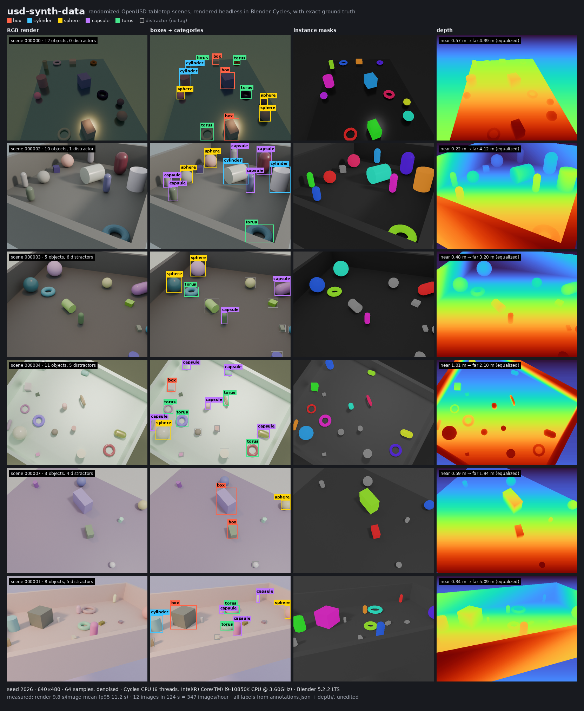
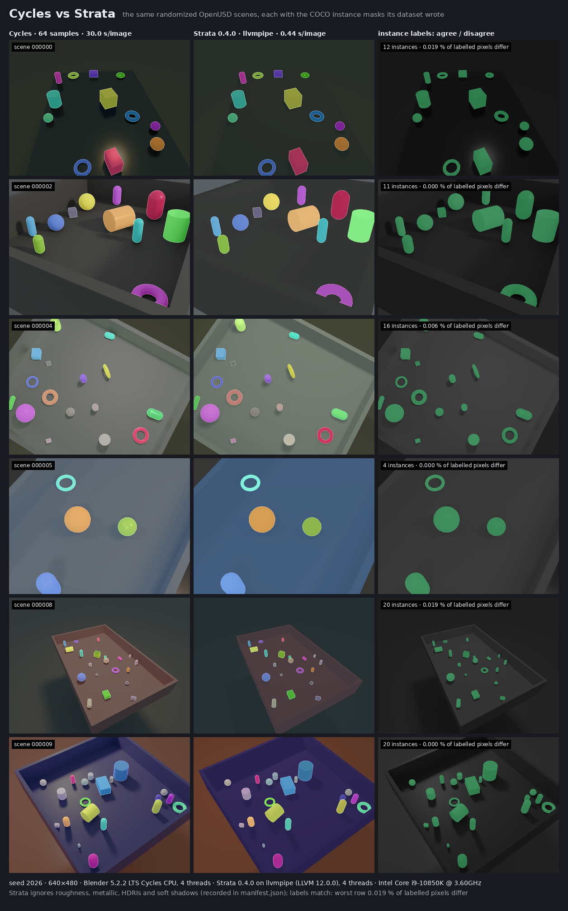
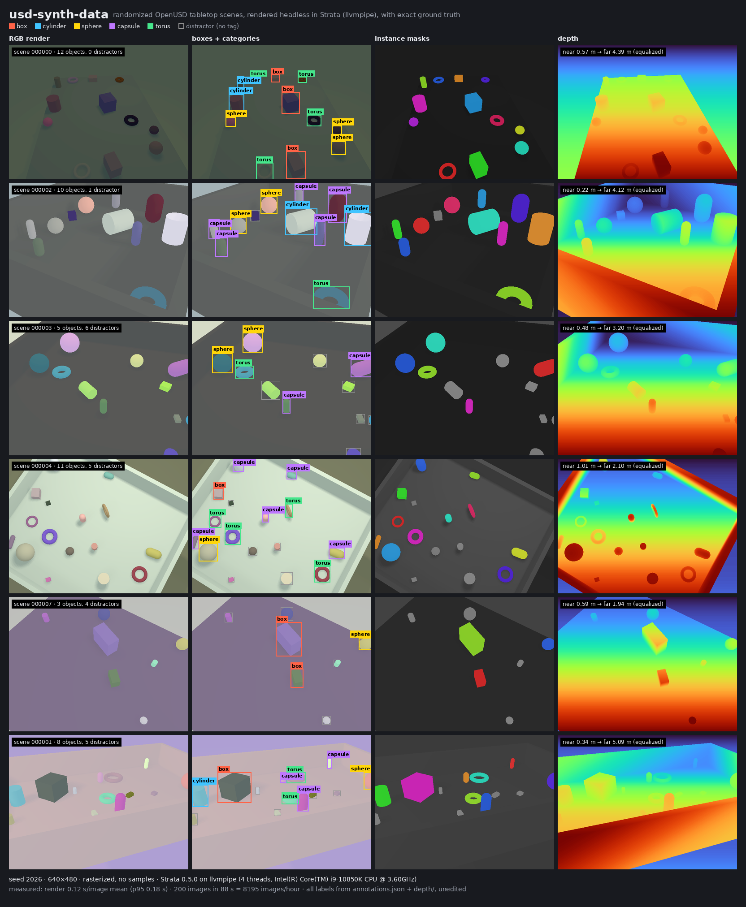
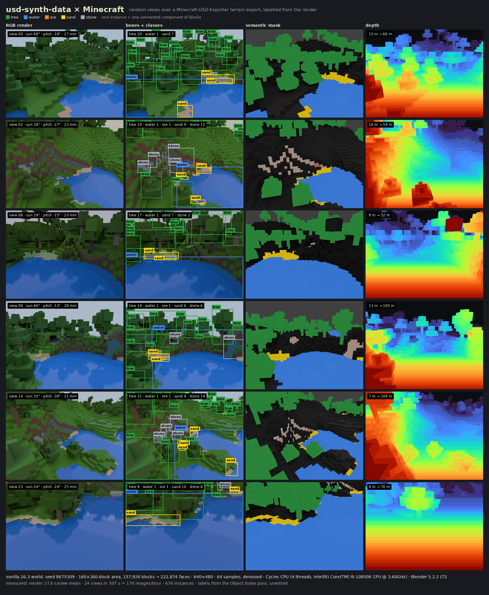
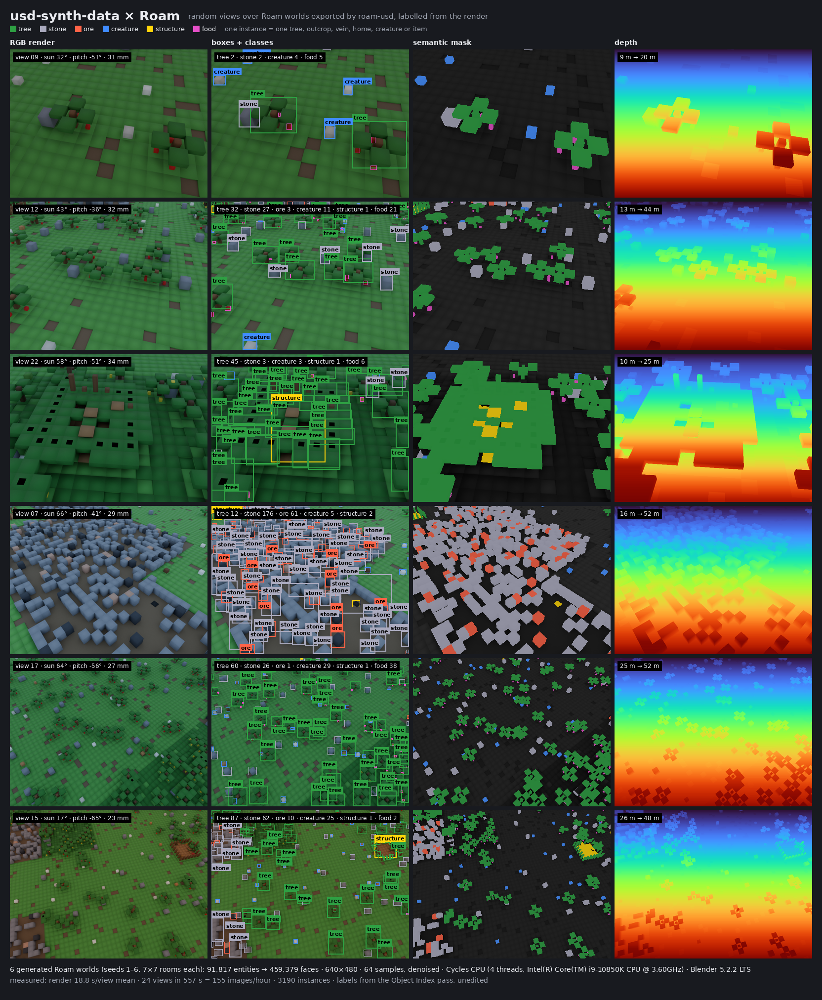
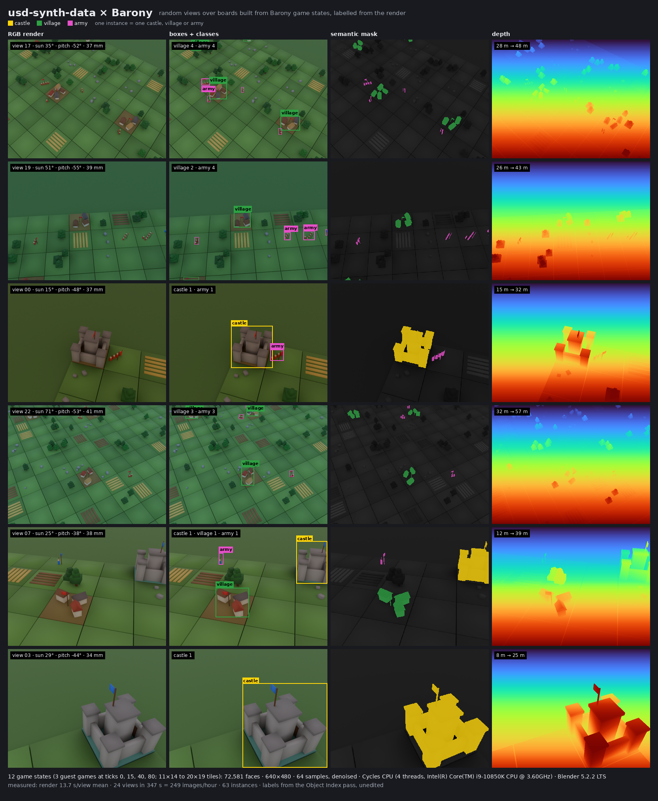

# usd-synth-data

**usd-synth-data** is a **procedural synthetic-dataset generator** for computer-vision and
robotics perception training.
It writes randomized **OpenUSD** scenes, renders them headless with **Blender Cycles**, and
emits RGB images with exact ground truth — **2D bounding boxes, instance masks and depth** — as
a **COCO-style** dataset. Rendering fans out as **Kubernetes Jobs** on any cluster, and
**throughput (images/hour)** is measured and reported on every run.



*Six scenes from `usd-synth generate --seed 2026` (640×480, 64 samples, denoised, about 10 s per
image on 6 CPU threads), each beside the ground truth the pipeline wrote for it; rebuild with
[`scripts/contact_sheet.py`](scripts/contact_sheet.py).*

> **Status: MVP complete (M1–M7).** Scene generation, headless rendering, labels, COCO output,
> reproduce, throughput reporting, local sharding and Kubernetes fan-out to S3-compatible
> storage all work and are tested in CI (including a `kind` cluster run). See
> [MVP.md](MVP.md) for the milestones and their pull requests.

---

## 🚀 Why usd-synth-data Exists

Labelling real images by hand is slow and inconsistent, and some labels (per-pixel depth,
pixel-exact masks) are impractical to label at all. When a program builds the scene, every label
is known exactly — but only if the pipeline also gives you **variety**, **reproducibility** and
**throughput**.

With usd-synth-data:
- Every scene is randomized from a declarative config: objects, poses, clutter, lighting,
  materials and camera placement (domain randomization).
- Every image is reproducible from the config, the dataset seed and its scene index.
- Every scene is a plain `.usda` file you can open in any USD viewer or diff as text.
- Every run tells you how many images per hour it produced, and where the time went.

---

## 🌍 A Day in the Life with usd-synth-data

1. **Describe the scene space** in `configs/tabletop.yaml`: which objects, how many, how
   cluttered, what lighting and camera ranges.
2. **Generate a pilot set locally**: `usd-synth generate --config configs/tabletop.yaml --seed 42 --count 200 --out out/ds`.
3. **Inspect one odd image** by opening its `scenes/scene_000137.usda`, or regenerate it exactly
   with `usd-synth reproduce --dataset out/ds --image-id 137 --out out/repro`.
4. **Scale out** by rendering the same config as a sharded Kubernetes Indexed Job, then merge
   the shards into one COCO dataset — identical in content to a local run.
5. **Compare throughput** across sample counts or resolutions from `throughput.json`.

---

## 🎯 Purpose

Core responsibilities:
- Sampling randomized tabletop / bin-picking scenes and writing them as flattened OpenUSD stages.
- Rendering each stage headless (Blender Cycles; CPU by default, GPU optional).
- Deriving ground truth from render passes: 2D boxes, instance segmentation (COCO RLE), depth.
- Writing a validated COCO-style dataset plus a provenance manifest.
- Sharding work across processes or Kubernetes Jobs and merging the results.
- Measuring and reporting throughput as a first-class output.

---

## 📦 Features (MVP Scope)

See [MVP.md](MVP.md) for the full scope, acceptance criteria and milestones.

- **Scenario:** tabletop / bin-picking (an outdoor terrain scenario and physics-settled
  placement are planned after the MVP; the [world examples](examples/) already render
  Minecraft terrain, Roam worlds and Barony boards through the same worker, see below).
- **Randomization:** object selection and count, poses, distractor clutter, support surface,
  materials, key/dome lighting, camera distance/elevation/azimuth/focal length.
- **Labels:** RGB PNG, 16-bit depth PNG (millimetres), instance masks (RLE), tight boxes,
  categories.
- **Format:** COCO-style `annotations.json` validated with `pycocotools`.
- **Determinism:** seed-addressable scenes, independent of sharding.
- **Scale-out:** Kubernetes Indexed Job (one pod per shard) writing to S3-compatible object
  storage + merge step; local multi-process sharding (local filesystem) for single machines.
- **Throughput:** `throughput.json` with images/hour and per-stage timings.

---

## ⚡ Fast Tier: Strata Instead of Cycles

Set `render.engine: strata` (or use [`configs/tabletop-strata.yaml`](configs/tabletop-strata.yaml))
to render the same scenes with [Strata](https://github.com/Preponderous-Software/strata), a
rasterizer, headless on the CPU through Mesa llvmpipe. Cycles stays the default. Masks and boxes
come from an exact instance-ID pass, so the labels match Cycles; what you give up is the look:
no glossy or metallic surfaces, no HDRI lighting, hard shadows.



*The same six scenes (`--seed 2026`, 640×480) from two `usd-synth generate` runs, one per
engine, each overlaid with the masks from its own `annotations.json`; the right column marks
where the two label maps disagree (at most 4 pixels in an image). Measured on one machine
under heavy load: Cycles 30.0 s and Strata 0.44 s per render, 112 vs 2,712 images/hour
end to end. Rebuild with [`scripts/engine_compare.py`](scripts/engine_compare.py).*

```bash
export USD_SYNTH_STRATA=/path/to/libstrata-0.6.0-linux-x64.so   # from the Strata releases page
usd-synth generate --config configs/tabletop-strata.yaml --seed 42 --count 200 --out out/fast
```

It needs Mesa's EGL and llvmpipe (`apt install libegl1 libgl1-mesa-dri`); the worker image
already has both and the library. Depth comes from Strata's depth readback (ABI 1.9, Strata
0.5.0+); with Strata 0.4.0 the depth PNGs are empty and the manifest says `"depth": false`. Each
scene records what the rasterizer ignored. Strata is driven through its official Python
binding (`strata-engine`, installed with the package from the pinned Strata tag).



*Six of 200 scenes (`--seed 2026`, 640×480) rendered with Strata 0.5.0 on llvmpipe, with the
boxes, masks and depth PNGs `usd-synth generate` wrote (0.12 s per render, 8,195 images/hour
end to end on a lighter-loaded machine than the comparison above). Rebuild with
[`scripts/contact_sheet.py`](scripts/contact_sheet.py).* Details: [ARCHITECTURE.md, Strata backend](ARCHITECTURE.md#strata-backend).

---

## 🌐 World Domains

Besides the bundled tabletop scenario, the [`examples/`](examples/) directory turns worlds from
other programs into labelled datasets. Each example builds a stage in the usd-synth layout and
reuses the stock Blender worker, pass reader and COCO writer. Throughput is from one measured
run each: 640×480, 64 samples, denoised, Cycles on 4 CPU threads of a shared desktop CPU.

| Domain | World comes from | Labelled classes | Images/hour |
|---|---|---|---|
| [Minecraft](examples/minecraft/) | a Minecraft-USD-Exporter terrain export | tree, water, ore, sand, stone | 170 |
| [Roam](examples/roam/) | roam-usd stages of worlds made by Roam's own generator | tree, stone, ore, creature, structure, food | 155 |
| [Barony](examples/barony/) | game-state JSON from Barony's backend, built into a 3D board here | castle, village, army | 249 |
| Beyond Nations | not yet: it has no saves or export, so an exporter has to be written first ([what's needed](examples/README.md#beyond-nations-not-added-yet)) | — | — |

## 🧱 Example: Training Data from a Minecraft World

[`examples/minecraft/`](examples/minecraft/) renders random views of a Minecraft world and
labels **tree**, **water**, **ore**, **sand** and **stone**. The world is read from a terrain
export written by [Minecraft-USD-Exporter](https://github.com/Dans-Plugins/Minecraft-USD-Exporter).
Each connected group of blocks of a class becomes one instance. Every view gets an RGB image, a
semantic mask, depth and COCO boxes and masks, all taken from the render's Object Index pass.
The stock Blender worker, pass reader and COCO writer are reused; only the scene comes from
outside the package.



*Six of 24 views over a 160 × 160-block area of a fresh vanilla 26.3 world (seed 8675309),
rendered at 640×480 with 64 samples on 4 CPU threads; see
[`examples/minecraft/README.md`](examples/minecraft/README.md) to reproduce it.*

## 🌲 Example: Training Data from Roam Worlds

[`examples/roam/`](examples/roam/) renders random views of worlds from the game
[Roam](https://github.com/Preponderous-Software/roam), read from stages written by
[roam-usd](https://github.com/Preponderous-Software/roam-usd). It labels **tree**, **stone**,
**ore**, **creature**, **structure** and **food**. A tree is one trunk with its canopy, stone
and ore are connected outcrops and veins, the home is one structure, and each creature or food
item is its own instance. Only roam-usd's catalog colours are rendered, so the images contain
no Roam artwork.



*Six of 24 views over six worlds from `roam-usd generate --seeds 1..6 --radius 3` (7×7 rooms
each), rendered at 640×480 with 64 samples on 4 CPU threads; see
[`examples/roam/README.md`](examples/roam/README.md) to reproduce it.*

## 🏰 Example: Training Data from Barony Boards

[`examples/barony/`](examples/barony/) saves game states from a running
[Barony](https://github.com/Preponderous-Software/barony) backend over its HTTP API. It builds
a 3D board from each state and labels every **castle**, **village** and **army**. Barony draws
in 2D, so the board, buildings and soldier figures are this example's own geometry, built from
the state: owners by colour, army size by figure count, plus unlabelled scenery on empty tiles.



*Six of 24 views over 12 states from three guest games, rendered at 640×480 with 64 samples on
4 CPU threads; see [`examples/barony/README.md`](examples/barony/README.md) to reproduce it.*

---

## 🛠 Tech Stack

- Python 3.12+
- OpenUSD (`usd-core`)
- Blender 5.2 LTS (Cycles), run headless
- Optional: [Strata](https://github.com/Preponderous-Software/strata) 0.6.0 through its official
  Python binding (`strata-engine`, ctypes), on Mesa llvmpipe (`render.engine: strata`)
- NumPy, Pydantic, PyYAML, OpenEXR, Pillow
- boto3 (any S3-compatible endpoint)
- pycocotools
- Docker (render worker image)
- Kubernetes Indexed Jobs (any cluster ≥ v1.33; `kind` for local testing)
- S3-compatible object storage for cluster runs (MinIO for local testing)
- pytest, ruff
- usd-asset-gate (CI check of the committed and generated USD scenes)

---

## 📂 Documentation

| Document | What it covers |
|---|---|
| [CONCEPT.md](CONCEPT.md) | The problem, who it is for, what makes it interesting, non-goals, and prior art (BlenderProc, Kubric, Omniverse Replicator, Infinigen, Unity Perception). |
| [MVP.md](MVP.md) | The smallest end-to-end slice, in/out of scope, acceptance criteria, and the milestone list that maps 1:1 to GitHub issues. |
| [ARCHITECTURE.md](ARCHITECTURE.md) | Components, data flow, USD stage layout, config schema, label generation, renderer choice, Kubernetes topology, dependencies, testing, throughput, decisions, open questions. |

MVP work is tracked in the issues labelled
[`mvp`](https://github.com/Preponderous-Software/usd-synth-data/issues?q=label%3Amvp).

---

## 🚀 Getting Started

Install the package (Python 3.12+) and point it at an official Blender 5.2 LTS Linux build
(rendering runs on CPU; no GPU needed):

```bash
pip install -e '.[dev]'
export USD_SYNTH_BLENDER=/path/to/blender-5.2.2-linux-x64/blender
```

Quick start — generate a 4-image dataset at the bundled config's 640×480, then regenerate one
image from the manifest and compare it with the original (these lines are run as written by
`tests/test_pipeline.py`):

<!-- quickstart -->
```bash
usd-synth generate --config configs/tabletop.yaml --seed 42 --count 4 --out out/ds
usd-synth reproduce --dataset out/ds --image-id 2 --out out/repro
```

This writes `out/ds/images/*.png`, `out/ds/depth/*.png` (16-bit millimetres),
`out/ds/scenes/*.usda`, `out/ds/annotations.json` (COCO), `out/ds/manifest.json` and
`out/ds/throughput.json`, and prints a one-line images/hour summary; per-scene work lives under
`out/ds/shards/`. Re-running `generate` with the same arguments resumes and renders only
unfinished scenes. Use `--count 200` for a pilot set.

Scale out on one machine with `--workers N` (N shards in parallel, merged automatically), or
run shards separately and merge them:

```bash
usd-synth generate --config configs/tabletop.yaml --seed 42 --count 200 --out out/big --workers 2
usd-synth generate --config configs/tabletop.yaml --seed 42 --count 200 --out out/big2 \
  --shard-index 0 --shard-count 2   # ...and --shard-index 1, anywhere that writes out/big2
usd-synth merge --out out/big2
```

On a 10-core desktop CPU the bundled config renders about 300 images/hour with one process and
4 threads, and about 475 with two (see ARCHITECTURE.md, Throughput and performance).

Individual stages:

```bash
usd-synth config --config configs/tabletop.yaml   # validate a config, print its SHA-256
usd-synth scenes --config configs/tabletop.yaml --seed 42 --count 5 --out out/scenes
usd-synth render --config configs/tabletop.yaml --scenes out/scenes --out out/render
pytest                                            # run the test suite
```

Or in the render worker image (Blender 5.2.2 and Strata 0.6.0 included, CPU rendering):

```bash
docker build -t usd-synth .
docker run --rm -v "$PWD/out:/app/out" usd-synth generate --config configs/tabletop.yaml \
  --seed 42 --count 4 --out out/ds
```

### On a Kubernetes cluster

Any conformant cluster (v1.33+) and any S3-compatible object store work; no shared volume is
needed. Push the worker image somewhere the cluster can pull from, create the bucket, and put
the store's endpoint and credentials in a Secret (they never go in the dataset config):

```bash
docker build -t registry.example.com/usd-synth:0.1.0 . && docker push registry.example.com/usd-synth:0.1.0
kubectl create secret generic usd-synth-s3 \
  --from-literal=AWS_ENDPOINT_URL=https://s3.example.com \
  --from-literal=AWS_ACCESS_KEY_ID=... --from-literal=AWS_SECRET_ACCESS_KEY=...
usd-synth k8s-manifest --config configs/tabletop.yaml --seed 42 --count 10000 --shards 50 \
  --out s3://datasets/tabletop-42 --image registry.example.com/usd-synth:0.1.0 --cpu 4 \
  | kubectl apply -f -
```

This creates a ConfigMap with the config, an Indexed Job (one pod per shard; a failed or
deleted pod is retried and resumes from its finished scenes) and a merge Job that waits for
all shards and writes the dataset, including cluster and per-pod images/hour in
`throughput.json`, to `s3://datasets/tabletop-42/dataset/`. Omit `AWS_ENDPOINT_URL` for AWS S3
itself. `usd-synth merge --out s3://…` also works from any machine with the same environment
variables. To try it locally, `scripts/kind-e2e.sh` runs the whole flow on a throwaway `kind`
cluster with MinIO inside it (needs docker, kind and kubectl).

---

## 📄 License

This project is licensed under the MIT License — see [LICENSE](LICENSE).

**Copyright © 2026 Daniel McCoy Stephenson.**

---

## 📬 Contact

For inquiries, feature requests, or contributions, please open an issue:
https://github.com/Preponderous-Software/usd-synth-data/issues
