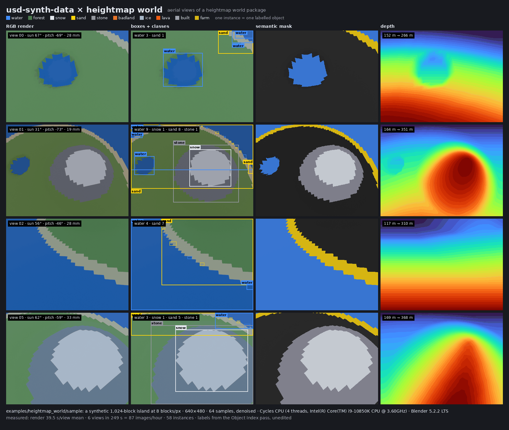

# Example: aerial training data from a heightmap world

The [Minecraft example](../minecraft/) works at block level, on an export of a few hundred
blocks square. This example works at world scale. It reads a **heightmap world package**: a
top-down summary of a large block world, one pixel per few blocks. From that it builds a
terrain mesh (kilometres across for a real world), renders randomized aerial (drone-style)
views of it with the stock usd-synth-data Blender worker, and writes for every view:

- an RGB image;
- a **semantic mask** (one ground class per pixel);
- a **depth map**;
- **COCO instance annotations** (tight boxes and RLE masks), one instance per region: a lake,
  a forest, a snowfield, a town.

A small synthetic package ships in [`sample/`](sample/), so the example runs without any game
files.



## The package format

A package is a folder. Coordinates are block coordinates of the source world: x east, z
south, y up.

### `world.json`

```json
{
  "format": "heightmap-world/1",
  "grid": {"origin_x": 0, "origin_z": 0, "blocks_per_px": 8, "width": 128, "height": 128,
           "y_offset": 1024},
  "classes": ["void", "water", "plain", "forest", "snow", "sand", "stone", "badland", "ice",
              "lava", "built", "farm"],
  "files": {"height": "height.png", "ground": "ground.png", "vectors": "vectors.json"}
}
```

Pixel (row *i*, column *j*) covers blocks x ∈ [`origin_x` + *j*·`blocks_per_px`, +
`blocks_per_px`) and z ∈ [`origin_z` + *i*·`blocks_per_px`, + `blocks_per_px`). `classes`
and `files` are optional; the values above are the defaults. Other keys (statistics, the
source's name) are ignored.

### Rasters

| File | Type | Meaning |
|---|---|---|
| `height.png` | 16-bit grey | top surface y + `y_offset`; 0 = no data for that pixel |
| `ground.png` | 8-bit grey | index into `classes`: 0 void, 1 water, 2 plain, 3 forest, 4 snow, 5 sand, 6 stone, 7 badland, 8 ice, 9 lava, 10 built, 11 farm |

On water the top surface is the water's surface. Pixels with no data, and void pixels, get no
geometry.

### `vectors.json` (optional)

Polygons are lists of `[x, z]` block coordinates.

| Key | Entries |
|---|---|
| `lakes` | `{polygon, area?}`: inland water |
| `forests` | `{polygon}`, or a circle `{at: [x, z], radius}` |
| `zones` | `{kind, polygon, area?}`, `kind` such as `snow`, `desert` or `badland` |

Other keys are ignored. Vectors change how regions are split into instances (see below), not
which class a pixel has.

## Classes and instances

The labelled classes are listed in [`heightmap_world.yaml`](heightmap_world.yaml) by ground
class name. By default every class except `plain` and `void` is labelled:

| Class | Instance = |
|---|---|
| `water`, `forest`, `snow`, `sand`, `stone`, `badland`, `ice`, `lava`, `built`, `farm` | a connected region of pixels of that class (8-connected by default, so a diagonal staircase of beach pixels is one beach; `connectivity: 4` joins along edges only) |

Where a vector feature covers part of a region, the pixels inside the feature form their own
instance. A lake polygon drawn over water that also touches the sea makes the lake a separate
instance from the sea. Each such instance records the feature (`lake_0`, `snow_2`, ...) as
`userProperties:usd_synth:feature`.

`plain` is rendered but unlabelled.

## How the scene is built

1. `hm_scene.read_package` reads the rasters (every `stride`-th pixel, for very wide
   worlds) and the vectors.
2. `hm_scene.build_scene` writes `scene.usdc` in the usd-synth stage layout. It is the same
   layout as the other world examples, written with the shared
   [`../common/worldviews.py`](../common/worldviews.py) helpers: Z-up, metres, one block =
   1 m (block x → x, block z → −y, block y → z).
   - The terrain is a heightfield with one quad per pixel. A quad's corners sit at the mean
     height of the surveyed pixels that share them, so neighbouring quads meet without gaps.
   - Each labelled region becomes one `/World/Objects/inst_NNNNN` mesh with the usual
     `userProperties:usd_synth:*` attributes, so the worker gives it its own Object Index.
     Unlabelled ground is tiled into `/World/Env` meshes.
   - With `trees.enabled`, proxy trees (a square trunk under a six-sided cone) are
     scattered over forest pixels, a Poisson number per pixel, at the terrain height under
     them. They are part of their forest's mesh, so a forest's mask covers its canopy as well
     as the ground under it. Where they stand comes from `stage_rng(seed, 0, "objects")`.
3. For each view, `hm_scene.sample_view` picks an aerial camera, and the shared
   `worldviews.write_view` writes `views/view_NNNN.usda` with the camera, a sun and a sky.
4. The shared `worldviews.render_views` renders the views and turns each Object Index pass
   into a semantic mask and COCO annotations; `worldviews.write_dataset` writes and checks
   `annotations.json`.

## Randomization

Each view is sampled from `stage_rng(seed, view, "camera" | "lighting")`, so view *i*
depends only on the seed and *i*:

- **Target:** classes take turns by view index. The camera is aimed near a random pixel of
  that class, offset by up to `aim_jitter_m`.
- **Camera:** altitude above the target, bearing, pitch and focal length are drawn from the
  config's ranges. A pose is redrawn if it is too close to the terrain under it, if a ridge
  blocks its line of sight to the target, or if any ray of a 9 × 7 pixel grid leaves the
  raster or travels farther than `max_range_m` before it reaches the lowest terrain. This
  keeps the world's edge and the sky out of frame, and keeps depth within the 655 m that a
  16-bit centimetre PNG holds.
- **Time of day:** sun elevation, azimuth and strength, as in the other world examples.

## Run it

You need the package installed (`pip install -e .`) and Blender (`USD_SYNTH_BLENDER`):

```bash
python examples/heightmap_world/hm_synth.py examples/heightmap_world/sample \
    --views 6 --seed 11 --out out/hm --threads 4
uv run examples/common/contact_sheet.py out/hm --views 0 1 2 3 \
    --title "usd-synth-data × heightmap world" --subtitle "aerial views of a heightmap package" \
    --source "examples/heightmap_world/sample (synthetic island)" \
    --out docs/images/heightmap-world-contact-sheet.png --colours 192
```

Output in `out/hm/`:

| Path | Contents |
|---|---|
| `scene.usdc` | the terrain as meshes; labelled regions under `/World/Objects` |
| `views/view_NNNN.usda` | one view: sublayers `scene.usdc` and adds the camera, sun and sky |
| `images/NNNN.png` | RGB |
| `semantic/NNNN.png` | 8-bit palette PNG; pixel value *k* = the *k*-th labelled class, 0 = unlabelled |
| `depth/NNNN.png` | 16-bit planar depth in centimetres (0 = sky or beyond 655 m) |
| `annotations.json` | COCO: images, instance annotations (`instance_id` kept), categories; `info.depth_scale_m` = 0.01 |
| `meta.json` | grid, classes, regions, per-view parameters and pixel counts, render settings, measured images/hour |
| `render/NNNN/` | the worker's raw output (`rgb.png`, `aux.exr`, `render.json`) |

## The sample package

[`sample/`](sample/) is a synthetic island, 1,024 blocks square, made by a small terrain
generator for tests rather than taken from a real world. It has sea around the edge, sand
beaches, a mountain with stone and a snow cap, and an inland lake. It is stored at 8 blocks
per pixel (128 × 128 px, a few kilobytes), with a `vectors.json` of its lake, a snow zone, a
desert zone and the landmass. It has no forest pixels, so it has no tree proxies; the tests draw packages
with forests.

## The image above

The image above shows four of six views (`--views 6 --seed 11`) over the sample. The figures
below were measured on one run, not benchmarked:

- **Scene:** 128 × 128 px at 8 blocks per pixel, 16,384 terrain quads, 37 labelled regions
  (water and sand have many: the beach is a ring one pixel wide, and taking every second
  pixel breaks it into short pieces). Building the scene took 0.3 s.
- **Rendering:** 6 views at 640 × 480, 64 samples, denoised, with Cycles on the CPU limited to
  4 threads (Intel Core i9-10850K, shared with other jobs), Blender 5.2.2. The 6 views took
  249 s including Blender start-up, USD import and labelling, which is **87 images/hour**.
- **Labels:** 58 instance annotations (27 water, 25 sand, 3 snow, 3 stone).

## Tests

`tests/test_heightmap_world_example.py` draws small packages pixel by pixel. It checks
reading (offsets, strides, no-data pixels, mismatched rasters), region splitting (including
vector features), quad placement and winding, tree proxies, the bundled sample and
deterministic aerial views. The Blender-marked test runs the driver on the sample, then
renders a known top-down view of a drawn island and checks the class under each region's
pixels.
